# nano_sequencer — architecture and inner workings

How the firmware is structured, what happens from reset to the main loop, how each part works, and what is still open. The standing rules for the codebase are in [CLAUDE.md](../CLAUDE.md) and the `CLAUDE.md` in each source folder; this document describes what is there.

How this was checked: the firmware is compiled with avr-gcc 12.1.0 under `-std=c99 -Wall -Wextra -Wconversion -Wshadow -Werror`, and the same source is compiled and tested on a PC with `make test`, the MCU adapters against fake registers. The refactored firmware has been flashed and run on the board; the later logger rewrite, the 115200 baud setting, the release build, the step advance, the timer tick with its non-blocking loop, the addressing, note mapping and rests, the shift registers on the SPI bus (which also needs three wires moved on the board), the gate and clock outputs, the pitch CV (which needs a DAC wired in), calibration with its storage in the EEPROM, the clock input, reset input, run button and sync switch (none of them wired yet), the mode switches with the five engines they choose beside the plain one (a ninth shift register, not wired yet), and the step lights (two more shift registers and sixteen LEDs, not wired yet) have not. Timing figures marked as measured come from the emulated board; the rest are calculated.

## At a glance

| | |
|---|---|
| Target | ATmega328P (Arduino Nano), 16 MHz |
| Flash used | 8132 bytes of 32 KB (debug build); 7056 bytes (release build) |
| RAM used | Debug: 653 bytes static (a 128-byte log queue, 321 bytes of message text and 51 bytes of scale tables copied from flash, 153 bytes of state). Release: 199 bytes (the tables and 147 bytes of state). Plus stack |
| Storage | 12 of the EEPROM's 1024 bytes: the pitch calibration record |
| Interrupts | One: Timer/Counter2 compare match A, 1000 times a second. It adds one to a counter and does nothing else. The clock and reset inputs use two interrupt flags, but polled, with their interrupts off |
| Main loop | Never blocks. One sequencer tick per millisecond; outputs are applied at the tick boundary |
| Inputs | 16 steps × 4 bits and 8 mode switches from nine 74HC165s on the SPI bus; one pot on ADC channel 6 for tempo. Both are read every 8 ms. A clock input (PB0), a reset input (PD2), a sync switch (PD3) and a run button (PD7), read every millisecond |
| Tempo | 30 to 285 BPM, a step being a sixteenth note (500 ms down to 52.6 ms per step) |
| Transport | The run button stops the pattern and starts it again from its first step. With the sync switch off the tempo pot sets the tempo; with it on a step begins on an edge at the clock input, and the pot is a ratio to that clock: a step to every 4, 3 or 2 edges, a step an edge, or 2, 3 or 4 steps an edge |
| Notes | A step's four switches are its note value: 0 is a rest, 1 to 15 a pitch through a scale and a root |
| Pattern | The core can play any range of steps forward, in reverse or as a pendulum, looping or once. The board has no controls for these yet, so the firmware plays all 16 steps forward, looping, in the chromatic scale. An edge at the reset input sends the pattern back to its first step, which plays at the next step boundary |
| Engines | The low three mode switches choose what the panel means, and the other five are the chosen engine's own. Plain: 16 steps, each one's switches its note. Stage: 8 stages, each with a note, a length of 1 to 4 steps and a gate mode. Klee: a pattern of bits going round a 16-stage register, the note being the sum of the values under them, with load, invert, merge and a chance of drifting. Chance: the plain steps, skipped or shuffled at random. Cartesian: the steps as a 4 by 4 grid crossed by two counters. Euclidean: the plain steps sounded on 1 to 16 beats spread evenly over a bar |
| Outputs | A pitch CV from an MCP4822 DAC on the SPI bus, 1 V to the octave from 0 V (0 to 3.75 V over the 45 semitones the core can ask for), unbuffered, through a calibration table that is the ideal one until a measured one is stored. A gate on PD4, high while a note is held (half a step), and a clock on PD5, one pulse per step; both are bare 0 V to 5 V logic pins. Sixteen step lights on two 74HC595s on the SPI bus: the light of the step playing flashes for the first half of it, and with the Klee engine the lights show its register. A serial log as well in the debug build (115200 baud) |
| Calibration | A mode entered by a panel pattern at power-on: the switches choose an octave, the tempo pot trims its voltage against a meter, and a switch stores it |
| Tests | 439 host tests in 37 programs (258 for the core, 54 for the app loop, 124 for the seventeen target adapter sources, 3 for `main.c`) |
| Coverage | 100% of lines (1214) and branches (550) in `core/`, `app/` and `adapters/target/`, measured on the PC build by `make coverage` |

## Hardware

What is wired to the chip, and which way each signal goes. The dotted path exists only in the debug build. [SCHEMATIC.html](SCHEMATIC.html) has the wiring pin by pin, with a diagram of each chip; open it in a browser.

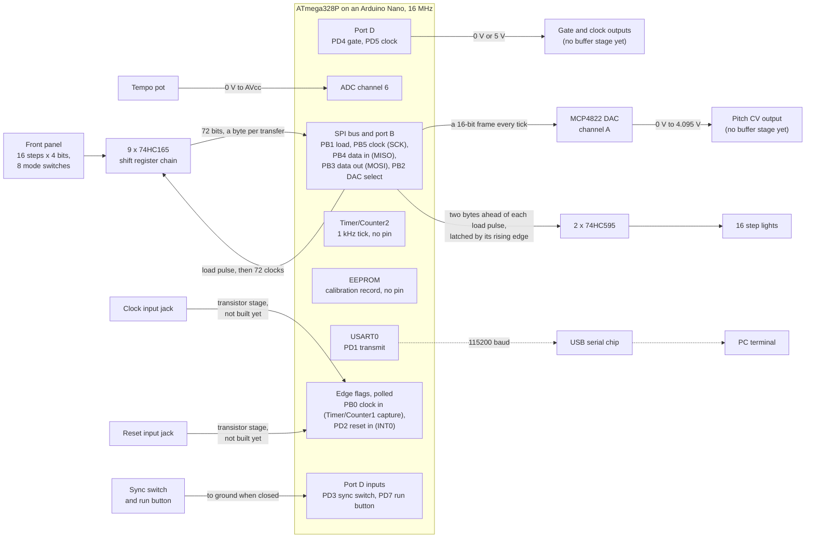

## Structure: ports and adapters

The sequencer logic is a pure core. It never touches hardware: the app gathers inputs through ports, hands them to the core, and applies what the core returns.

```mermaid
flowchart TD
    main["app/main.c<br/>init, then loop forever"] --> app["app/app.c<br/>gather, tick, apply"]
    app -->|"calls"| core["core/: seq, clock, transport, debounce,<br/>engine_plain, engine_stage, engine_klee, engine_chance,<br/>engine_cartesian, engine_euclid, prng, address, note_map, panel, gate,<br/>pitch_cal, cal, cal_record<br/>pure logic, no hardware"]
    app -->|"calls through"| ports
    subgraph ports["ports/ (headers only)"]
        p_platform["platform_port.h"]
        p_step["step_input_port.h"]
        p_tempo["tempo_input_port.h"]
        p_time["timebase_port.h"]
        p_cv["cv_output_port.h"]
        p_gate["gate_output_port.h"]
        p_clock["clock_output_port.h"]
        p_led["led_output_port.h"]
        p_in["clock_input_port.h<br/>reset_input_port.h<br/>run_input_port.h<br/>sync_input_port.h"]
        p_nv["nv_port.h"]
        p_reset["reset_cause_port.h"]
        p_log["log_port.h"]
    end
    subgraph target["adapters/target/ (linked into the firmware)"]
        t_init["init.c<br/>register_init.c"]
        t_shift["shift_reg_reader.c<br/>on spi.c"]
        t_adc["analog_reader.c"]
        t_time["timebase.c"]
        t_cv["cv_output.c<br/>on spi.c"]
        t_gate["gate_output.c"]
        t_clock["clock_output.c"]
        t_in["clock_input.c<br/>reset_input.c<br/>run_input.c<br/>sync_input.c"]
        t_nv["eeprom.c"]
        t_reset["reset_cause.c"]
        t_serial["serial_logger.c<br/>debug build"]
        t_null["null_logger.c<br/>release build"]
    end
    subgraph host["adapters/host/ (linked into the PC tests)"]
        h_ports["host_ports.c<br/>scripted inputs, recorded outputs"]
    end
    t_init -.->|"implements"| p_platform
    t_shift -.->|"implements"| p_step
    t_adc -.->|"implements"| p_tempo
    t_time -.->|"implements"| p_time
    t_cv -.->|"implements"| p_cv
    t_gate -.->|"implements"| p_gate
    t_clock -.->|"implements"| p_clock
    t_shift -.->|"implements"| p_led
    t_in -.->|"implement, one each"| p_in
    t_nv -.->|"implements"| p_nv
    t_reset -.->|"implements"| p_reset
    t_serial -.->|"implements"| p_log
    t_null -.->|"implements"| p_log
    h_ports -.->|"implements all fifteen"| ports
```

Solid arrows are calls; dotted arrows show which file supplies the functions a port header declares. The core sits to one side: it calls nothing and nothing but the app calls it.

| Folder | Role | May touch hardware |
|---|---|---|
| `core/` | Sequencer logic. Plain C99; includes only its own headers and `<stdint.h>`, `<stdbool.h>`, `<stddef.h>` | No |
| `ports/` | Headers describing what the app needs from outside: one small header per need | No |
| `adapters/target/` | The ports implemented for the ATmega328P | Yes — the only place |
| `adapters/host/` | The ports faked for PC tests: scripted inputs, recorded outputs | No |
| `app/` | Wires ports to the core; holds `main` | No |
| `tests/` | Host test programs and a small assert-based harness | No |
| `tools/sim/` | An emulated board that runs the built firmware images (JavaScript, not firmware source) | No |

Ports are bound at link time: the firmware links `adapters/target/`, the tests link `adapters/host/`, and both use the same headers. There are no function-pointer tables. The debug and release builds are the same idea one level down: `adapters/target/` holds two implementations of the log port, and the Makefile links one of them (see Build configurations below).

### The ports

| Port | Function | Target implementation |
|---|---|---|
| `platform_port.h` | `platform_init()` | `init.c`: logger, then pin directions and ADC, then the SPI bus, then the two edge inputs, then the timebase |
| `step_input_port.h` | `step_input_read(p_raw_bits, byte_count)` | `shift_reg_reader.c`: 74HC165 chain, read through the SPI driver `spi.c` |
| `led_output_port.h` | `led_output_write(leds)` | `shift_reg_reader.c` again: two 74HC595s, written as part of the next step input read |
| `tempo_input_port.h` | `tempo_input_read(p_raw)` | `analog_reader.c`: ADC channel 6 |
| `timebase_port.h` | `timebase_elapsed_ticks()` | `timebase.c`: Timer/Counter2 interrupting at 1 kHz |
| `cv_output_port.h` | `cv_output_write(millivolts)` | `cv_output.c`: channel A of an MCP4822 DAC, written through the SPI driver `spi.c` |
| `gate_output_port.h` | `gate_output_write(b_high)` | `gate_output.c`: PD4 |
| `clock_output_port.h` | `clock_output_write(b_high)` | `clock_output.c`: PD5 |
| `clock_input_port.h` | `clock_input_edge()` | `clock_input.c`: PB0, through the input capture flag of Timer/Counter1 |
| `reset_input_port.h` | `reset_input_edge()` | `reset_input.c`: PD2, through the flag of external interrupt 0 |
| `run_input_port.h` | `run_input_read()` | `run_input.c`: PD7 |
| `sync_input_port.h` | `sync_input_read()` | `sync_input.c`: PD3 |
| `nv_port.h` | `nv_read(address, p_data, count)`, `nv_write(address, p_data, count)`, `nv_poll()` | `eeprom.c`: the MCU's 1024-byte EEPROM |
| `reset_cause_port.h` | `reset_cause_read()` | `reset_cause.c`: the MCU's reset flags |
| `log_port.h` | `log_step_note(step, semitone)`, `log_step_rest(step)`, `log_startup(reset_cause, b_calibrated)`, `log_cal_point(point, cv)`, `log_transport(mode)`, `log_error(what, status)`, `log_poll()`, `log_flush()` | `serial_logger.c`: USART0 (debug build), or `null_logger.c`: discards everything (release build) |

Functions that can fail return `port_status_t` (`STATUS_OK` = 0, `ERR_INVALID_PARAM` = 2, `ERR_BUSY` = 3, `ERR_TIMEOUT` = 4, and so on). The numbers appear in the debug build's serial log, so they are fixed. `timebase_elapsed_ticks()` cannot fail and returns the tick count itself, and `reset_cause_read()` the reset flags. The gate and clock output writes cannot fail either and return nothing; the pitch CV write goes over the bus and returns a status. The four transport inputs cannot fail: the two edge inputs say whether an edge has arrived since they were last asked, and forget it; the button and the switch give their level as it is, bounce and all.

## What "bare metal" means here

No source file includes an avr-libc header. Registers are declared in `adapters/target/atmega328p_regs.h` (with `atmega328p_usart_regs.h` for USART0, `atmega328p_timer2_regs.h` for Timer/Counter2, `atmega328p_spi_regs.h` for the SPI, `atmega328p_eeprom_regs.h` for the EEPROM, `atmega328p_timer1_regs.h` for Timer/Counter1 and `atmega328p_extint_regs.h` for the external interrupts) and placed by the linker. Interrupts are enabled by setting the bit in the status register, and the one interrupt handler is an ordinary C function given avr-gcc's `signal` attribute and the name the vector table expects (`__vector_7`). No compiler builtin is used. There is no `printf`, `memset` or any other library function; the logger converts numbers to text itself. The build uses `-ffreestanding`, so `<stdint.h>`, `<stdbool.h>` and `<stddef.h>` are the compiler's own.

The link step is not library-free. The Makefile links with plain `avr-gcc -mmcu=atmega328p`, so the map file shows:

- `crtatmega328p.o`, which ships with avr-libc. It supplies the interrupt vector table, `__bad_interrupt`, and the `__init` code that sets the stack pointer and calls `main`. Every vector but the reset and the timer tick still points at `__bad_interrupt`.
- From libgcc: `__do_clear_bss`, `__do_copy_data`, `_exit`, and `__udivmodhi4` (16-bit divide, used when converting numbers to decimal and when interpolating a pitch CV value), and `__udivmodqi4` (8-bit divide, used by the note mapping).
- `libc.a` and `libm.a` are searched, but nothing is pulled from them.

## Reset to main loop

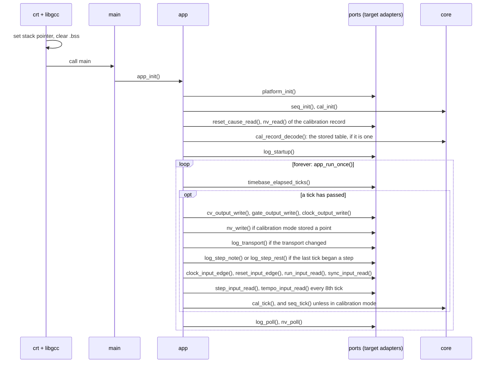

`platform_init()` ends by starting the timer and enabling interrupts, so the tick is running before the first pass of the loop. `app_init()` then reads why the processor started and the calibration record from the EEPROM, and logs both in one line (`Reset = 2 Cal = 1`). The read takes a few tens of microseconds. If `platform_init()` fails, `app_init()` logs it, waits for the log to be sent (`log_flush()`, the only blocking call left) and `main` returns the status; execution then falls into libgcc's `_exit`, which disables interrupts and loops forever. Neither target init function can currently fail.

The same thing as states:

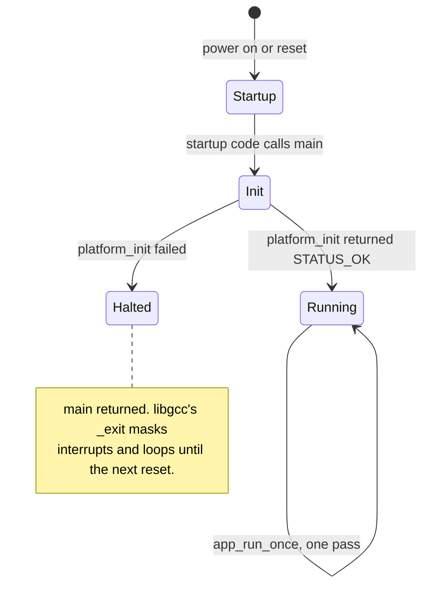

## The main loop and one tick

`main` calls `app_run_once()` in [`app/app.c`](../app/app.c) forever, and that function never waits. Each pass asks the timebase how many 1 ms ticks have gone by since the last pass.

- **None:** the pass gives the log the chance to send one byte and the EEPROM the chance to start writing one, and returns. Between ticks the loop spins through this path, a few microseconds a time.
- **One or more:** the pass runs one tick of the sequencer, in the three steps below, and then polls the log and the EEPROM as well. More than one only happens if a pass overran; the count is handed to the core, so no time is lost.

1. **Apply outputs.** What the previous tick computed is acted on first. The pitch CV is written, then the gate and the clock output are set to their levels, all three on every tick, before anything else. Then log the transport if it changed (stopped, started, or another clock) and, if a step began, the step and its pitch, or that it is a rest (or one error if the step read had failed), an error if the tempo read had failed, and an error if this tick's write of the pitch CV failed.
2. **Gather inputs.** Note the elapsed ticks. On every tick ask the clock input and the reset input whether an edge has arrived, and read the run button and the sync switch: each is one or two instructions, and an edge is only held until it is asked for. Every eighth tick (125 times a second) read 9 raw bytes from the step input port (the steps' eight and the mode switches' one) and one reading from the tempo port; each read's success becomes a valid flag in `seq_inputs_t`. Between scans the core is given the last snapshot again.
3. **Run the core.** `seq_tick()` settles the button and the switch and decides whether the pattern is running and from which clock. If it is running, it moves its clock on, by the elapsed ticks or by the external edge, and, if that brings a step due, begins it and works out its pitch. It also works out the pitch CV value and the level of the gate and of the clock output as they should stand after this tick. The result is kept until the next tick.

Calibration mode is the one exception to step 3. `cal_tick()` is called first on every tick; on the first it looks at the panel, and if the panel asks for calibration it is `cal_tick()` that gives the pitch CV and the gate from then on, and `seq_tick()` is not called at all (see "Calibration mode" below). When it stores a point, the apply step of the next tick starts the write of the calibration record, after the three outputs.

Outputs are applied at the start of the next tick, not at the end of this one, so they change at the same point in every tick however long the reads and the core took. The price is that every output is one tick (1 ms) late, always by the same amount. The pitch CV, the gate and the clock output go first so that queueing a log line cannot hold their edges up, and the pitch goes ahead of the gate so that it is in place when the note starts. The pitch is written on every tick, changed or not, for the same reason the pins are: the apply step then takes the same time on every tick, so the gate and clock edges stay where they are in the tick whether or not a note is starting, and a write that failed is put right a millisecond later.

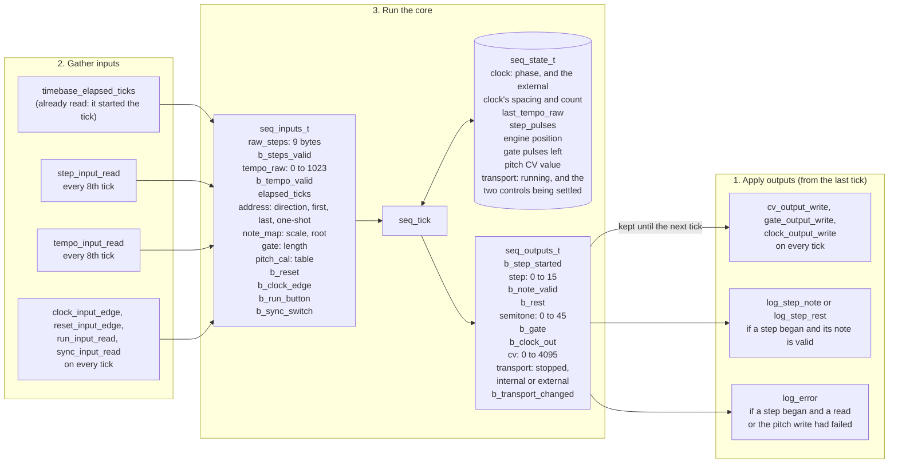

The two read statuses are kept beside the snapshot (not passed through the core), so a failed read can be logged with its status code. A failed read is reported once per step, along with the step it affected, not once per scan.

Three of the inputs in the diagram (the addressing controls, the scale and root, and the gate length) have no hardware behind them yet. The app sets them once, in `set_fixed_controls()`: all sixteen steps, forward, looping, in the chromatic scale from the lowest pitch, with a gate of half a step. When there are switches or pots for them, that function is what a port read replaces. The calibration table is set there too, to the ideal one (1000 mV to the octave from 0 V), and then replaced by the one stored in the EEPROM, if there is one. The last four inputs are the transport's, and come from their ports on every tick.

A tick is a millisecond, not a step. A step lasts 24 clock pulses, which at the tempo set by the pot is 500 ms down to 52.6 ms, so most ticks compute nothing new and apply nothing. Sixteen steps go once round the pattern.

**Timing, measured on the emulated board** at 150 BPM, where a step is exactly 100 ms:

| | Debug | Release |
|---|---|---|
| Panel scan period | 8 ms, within 0.12 ms | 8 ms, within 0.004 ms |
| Step period, from one rising edge of the clock output to the next | 100 ms, within 0.003 ms | 100 ms, within 0.003 ms |
| Gate, and the high half of the clock output | 50 ms, within 0.003 ms | 50 ms, within 0.003 ms |
| Gate edge to clock output edge | 0.9 µs, gate first | The same |
| Pitch CV write | Once a tick, to within 0.003 ms; DAC selected for 20.1 µs | The same |
| DAC takes a note's pitch to its gate rising | 1.6 µs, pitch first | The same |
| First gate | 2.3 ms after reset | 2.1 ms after reset |
| Step period, from the first byte of one log line to the first byte of the next | 100 ms, within 0.25 ms | No log |
| Gate rising to the first byte of its step's log line | 0.13 to 0.31 ms | — |
| One log line on the wire | 1.0 ms (a rest) to 1.6 ms, sent a byte per pass while the loop carries on | — |
| Start-up line (`Reset = 0 Cal = 0`) | Sent from 0.5 ms to 2.6 ms after reset | — |
| First step logged | 2.6 ms after reset | — |
| Storing a calibration point | Pitch CV still written once a tick, to within 0.02 ms, while the EEPROM is written | The same |
| An edge at the clock input to its step's gate and clock output | 1.0 to 2.0 ms, depending on where in a tick the edge falls; a tick more for an edge that comes in under half the gap before it | The same |
| Step period on a steady external clock of 80 ms | 80 ms, within 0.02 ms | The same |
| A press of the run button to the pattern stopping or starting | 20 to 21 ms after the contact settles | The same |

Adding the pitch CV write ahead of the gate moved every gate and clock edge about 22 µs later in its tick and changed none of the widths or periods above, because the write happens on every tick. Polling the EEPROM on every pass of the loop changed none of them either.

The debug build's figures after reset moved with phase 5, for two reasons that have nothing to do with the tick itself. Its timer starts about 0.1 ms later than it did (0.3 ms after reset), because the startup code has more message text to copy into RAM before `main` runs. And the first step's log line now waits for the start-up line ahead of it in the queue.

The step itself begins on a tick boundary in both builds, and the gate and clock output show it: their edges keep time to a few microseconds, which is how long the idle loop takes to notice a tick, and the log being sent makes no difference to them. The 0.25 ms on the log's row is the log's own jitter: a line's first byte goes out at the end of that tick's pass, after the line has been queued and, on a scan tick, after the panel and pot have been read. Over a long run nothing accumulates: 16 steps took 1600 ms to within the same margins.

The very first step is as long as the rest. The tick that starts the pattern, after reset or after the run button, begins its first step and does not count that tick's time towards the second. (Until phase 6 it did, and the first step was a millisecond short.)

Reading the four transport inputs on every tick, and the two timers and flags set up for them, moved nothing above by more than a few microseconds.

On the external clock an edge is noticed at the next tick boundary and acted on at the one after, which is the same one-tick delay every output has, plus up to a tick of waiting to be noticed. So a step begins 1 to 2 ms after its edge. When the clock's period is a whole number of milliseconds that delay is the same every time; when it is not, steps move against their edges by up to a tick. Timing an edge more finely than a tick would take the timer's capture value, which is not used (the roadmap's phase 11).

## The core — `core/`

```c
void seq_init(seq_state_t *p_state);
void seq_tick(seq_state_t *p_state, const seq_inputs_t *p_in, seq_outputs_t *p_out);

void    clock_init(clock_state_t *p_state);
uint8_t clock_advance(clock_state_t *p_state, uint16_t bpm, uint8_t elapsed_ticks);
uint8_t clock_follow(clock_state_t *p_state, const clock_follow_t *p_in);

void transport_init(transport_state_t *p_state);
void transport_tick(transport_state_t *p_state, const transport_inputs_t *p_in,
                    transport_outputs_t *p_out);

void debounce_init(debounce_state_t *p_state);
bool debounce_update(debounce_state_t *p_state, bool b_raw, uint8_t elapsed_ticks);

void engine_plain_init(engine_plain_state_t *p_state);
bool engine_plain_step(engine_plain_state_t *p_state, const engine_inputs_t *p_in,
                       engine_step_t *p_step);

void engine_stage_init(engine_stage_state_t *p_state);
bool engine_stage_step(engine_stage_state_t *p_state, const engine_inputs_t *p_in,
                       engine_step_t *p_step);
// engine_klee, engine_chance, engine_cartesian and engine_euclid: the same pair each

void    prng_init(prng_state_t *p_state, uint16_t seed);
uint8_t prng_byte(prng_state_t *p_state);

void address_init(address_state_t *p_state);
bool address_next(address_state_t *p_state, const address_config_t *p_config,
                  uint8_t *p_step);

bool    note_map_semitone(const note_map_config_t *p_config, uint8_t note,
                          uint8_t *p_semitone);
uint8_t panel_step_value(const uint8_t *p_raw_steps, uint8_t step);
uint8_t panel_mode_value(const uint8_t *p_raw_steps);

void gate_init(gate_state_t *p_state);
void gate_begin(gate_state_t *p_state, const gate_config_t *p_config, bool b_note);
bool gate_advance(gate_state_t *p_state, uint16_t pulses);

uint16_t pitch_cal_cv(const pitch_cal_config_t *p_config, uint8_t semitone);

void cal_init(cal_state_t *p_state);
void cal_tick(cal_state_t *p_state, const cal_inputs_t *p_in,
              pitch_cal_config_t *p_table, cal_outputs_t *p_out);

void cal_record_encode(const pitch_cal_config_t *p_table, uint8_t *p_bytes);
bool cal_record_decode(const uint8_t *p_bytes, pitch_cal_config_t *p_table);
```

`seq_tick()` reads the state and inputs, writes the state and outputs, and does nothing else. Every function under it is the same kind of function one level down, and each module has its own test program. `cal` and `cal_record` stand beside the sequencer, not under it: the app calls them itself, and the sequencer knows nothing of them. They share only the calibration table type with it.

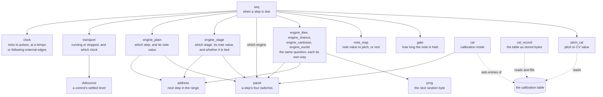

| Module | Question it answers | State it keeps |
|---|---|---|
| `seq` | Is a step due on this tick, and what are the outputs? | Tempo reading, pulses into the step, the pitch CV value of the last note, and the clock, transport, engine and gate below |
| `clock` | How many pulses fell in these ticks? | The phase, and for an external clock the spacing of its edges, the time since the last, and what has been given since: 10 bytes |
| `transport` | Is the pattern running, and from which clock? | Running or not, the mode last reported, the button as last settled, and the two controls being settled: 11 bytes |
| `debounce` | What level has this button or switch settled at? | The level, whether one has been taken yet, and how long the reading has differed: 3 bytes |
| `engine_plain` | Which step plays now, and what is its note value? | The addressing state |
| `engine_stage` | Which stage plays now, what is its note value on this step of it, and is it tied to the next? | The addressing state, the stage, its length and how many of its steps have played: 5 bytes |
| `engine_klee` | What is the sum under the register's active stages, now that it has moved? | The register, how far it has moved since a load, whether it has been loaded, and the load switch as last seen: 5 bytes |
| `engine_chance` | Which step plays now, in order or picked at random, and is it skipped? | The addressing state |
| `engine_cartesian` | Which step is at the crossing of the two counters? | The two counters and how long since each moved: 4 bytes |
| `engine_euclid` | Which step plays now, and does it fall on a beat? | The addressing state and the place in the bar: 3 bytes |
| `prng` | What is the next random byte? | A 16-bit register |
| `address` | Which step comes next in this direction and range? | A count of steps played in the cycle, and a finished flag |
| `note_map` | What pitch is this note value in this scale? | None |
| `panel` | What do the four switches of this step read, and the eight mode switches? | None |
| `gate` | Is the note still held? | Pulses left before the gate closes |
| `pitch_cal` | What CV value gives this pitch? | None |
| `cal` | Is this calibration mode, and if so what voltage is being set and is it to be stored? | The mode, the point, the last trim reading, the store switch as last seen, and how long the gate has still to stay low: 7 bytes |
| `cal_record` | Are these stored bytes a calibration table, and which? | None |

### The clock

The clock turns elapsed ticks into pulses, 96 to the quarter note, at a tempo in beats per minute. At B BPM there are B × 96 pulses in 60000 ticks, which is B × 8 pulses in 5000 ticks. So each tick adds B × 8 to a 16-bit phase counter, and each time the counter reaches 5000 one pulse is emitted and 5000 is taken off. Nothing is rounded, so the pulse count is exact however long it runs: the tests count exactly B × 96 pulses in a minute for a range of tempos, and no drift over ten minutes. Rounding the pulse period to whole ticks instead would be 4 % out at the fast end.

The tempo is limited to 300 BPM, which keeps the counter within 16 bits and means a tick never holds more than one pulse. A tempo of 0 stops the clock.

### Following an external clock

`clock_follow()` is the other way the clock gives pulses: in step with edges from outside. It is given, on each tick, whether an edge arrived, the time elapsed, and a ratio in two parts, a divide and a multiply.

- **Sync edges.** Every divide-th edge is a sync edge, the one the pattern locks to. With a divide of 1 every edge is one. The first edge after the clock starts following is always one, whatever the divide.
- **A stretch** is the time from one sync edge to the next, and the clock gives exactly 24 × multiply pulses in each. At a ratio of one that is a step (24 pulses, a sixteenth note) to an edge; a multiply of 4 fits four steps in; a divide of 4 makes a step last four edges.
- **Spacing.** Within a stretch the pulses are spaced as if it will be as long as the last one was, counted in ticks between the two sync edges. If the next sync edge is late, the clock stops one pulse short and waits, so a step never begins ahead of its edge. When the edge comes it gives whatever is left, so the total is exact and steps stay on sync edges however the tempo moves.
- **No spacing yet.** The first stretch has nothing to go by, and neither has one that follows a gap of 4 seconds or more. It is taken to be 20 ticks long and its multiply to be 1: the step on that edge has a gate and a clock pulse of 10 ms, and the steps a multiply would fit in begin with the next sync edge.
- **The ratio** is read at each sync edge and holds until the next.
- **Changing over.** Running at a tempo ends the following, so the next `clock_follow()` starts afresh. Its first sync edge returns as many pulses as the caller says are left before its next step, so that step begins on the edge wherever the caller had got to; before that edge, pulses come at the 20-tick rate and stop one short, which winds up a step that was begun at a tempo.

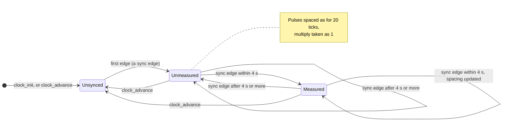

Edges are seen once a tick, so the spacing is known to the millisecond and no finer.

### The transport

`transport_tick()` turns the run button and the sync switch into one of three modes: stopped, running from the internal clock, running from the external clock. It debounces both controls itself.

- **The run button** toggles: each press, once it has settled, stops the pattern if it is running and starts it if it is stopped. Holding it is one press.
- **The sync switch** chooses the clock while the pattern runs: off is internal, on is external. It does nothing while stopped, but is looked at when the pattern starts.
- **After `transport_init()`** the pattern is running. A button that is already down then is not a press, and a switch that is already on is on from the first tick.
- **A start** is reported on the first tick after init and on each tick the button starts the pattern again, and a change of mode on any tick whose mode differs from the last one's. A change of clock is not a start.

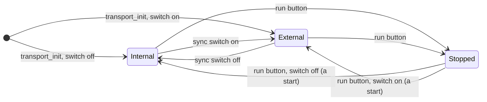

### Debounce

`debounce_update()` gives the settled level of one button or switch. The first reading after `debounce_init()` is taken as it stands. After that the level changes only when the raw reading has differed from it for 20 ticks without a break; one reading back at the old level starts the count again. So a press is acted on 20 ms after the contact stops bouncing, and anything shorter than 20 ms is ignored. Time is counted in elapsed ticks, so a stalled loop does not stretch it.

### The sequencer

- **Transport.** The sequencer runs the transport first on every tick, from the run button and the sync switch as read. A start (the first tick after `seq_init()`, and each time the button starts the pattern again) puts the clock, the engine and the gate back to their beginning and does not count that tick's elapsed time, so the step it begins is a whole one. While the pattern is stopped nothing is due and nothing begins: the gate is closed at once, the clock output is low, the pitch CV holds, and reset and the external clock are ignored.
- **Tempo.** On the internal clock the tempo reading (0 to 1023) maps linearly onto 30 to 285 BPM: 30 plus the reading divided by 4. The floor means the pot cannot stop the pattern or run it at an unusable speed. When a tempo read fails, the previous reading is reused, so the pattern keeps its pace. Before any valid reading the tempo is 30 BPM.
- **Ratio.** On the external clock the same reading is a ratio, in seven parts of 147 counts (the last a few short): a step to every 4, 3 or 2 edges over the lowest three, a step an edge in the middle (441 to 587), and 2, 3 or 4 steps an edge over the top three. There is no hysteresis, so a pot left on a boundary can give either ratio at each sync edge. A failed read reuses the last reading here too.
- **Step length.** A step is a sixteenth note: 24 pulses. On the internal clock that is 15000 / BPM milliseconds; on the external one it is whatever the edges and the ratio make it. `step_pulses` counts the pulses since the current step began.
- **Step advance.** When `step_pulses` reaches 24 a step is due, and the engine is asked for it. If it has one, the outputs carry `b_step_started`, the step and what it plays. On every other tick `b_step_started` is false and the other outputs are zero. A start on the internal clock begins the first step of the pattern on the same tick; on the external clock the first step waits for the first edge.
- **An early edge.** On the external clock the gate and the clock output are high for half a step as estimated from the last gap, so an edge that comes in under half that gap finds both still high. Its step is held back one tick: on the tick it falls due the gate is closed and the clock output is low, and the step begins on the next. Every step therefore has a rising edge of its own on both outputs, at the price of that step being a millisecond late. A gate tied to the next note by its length is not affected, since the clock output has fallen by then. The internal clock is left as it was: there a step can only fall due with the clock output high after a stalled loop, and it begins at once.
- **A change of clock** does not restart the pattern. Going to the external clock, the step in progress is wound up within 20 ms (its gate closes and the clock output falls) and the next waits for an edge. Going back, the internal clock carries on from where the pattern is.
- **Which engine.** When a step is due, the low three mode switches are read as a number, from the panel as it was last read: 0 plain, 1 stage, 2 Klee, 3 chance, 4 Cartesian, 5 Euclidean, and 6 and 7, which have no engine, plain. The other five switches are the chosen engine's to read. If the engine is not the one that played the last step, every engine is sent back to the start of its pattern first, so a change of engine begins the new pattern at its beginning, on the beat.
- **What a step plays.** Only the step that is beginning is read, from the inputs of that tick, so a change on the panel is heard the next time its step comes round. Its note value goes through the note mapping: 0 sets `b_rest`, anything else gives `semitone`. If the step inputs are flagged invalid, `b_note_valid` is false and the step is neither a rest nor a pitch; it still begins on time, so a failed read does not shift the pattern.
- **Reset.** While `b_reset` is true the engine is sent back to the start of its pattern on every tick. The clock is not touched, so the first step plays at the next step boundary, where the next step would have been anyway, and holding reset repeats the first step. On the board `b_reset` is true for the one tick after an edge at the reset input. On the external clock the next step boundary is the next sync edge; a reset that arrives in the same tick as that edge counts for it, and one that arrives a tick later lets the wrong step begin first.
- **A finished pattern.** When a one-shot pattern has played, the clock keeps running and steps keep falling due, but none begins. A reset, or going back to looping, starts it again on the beat.
- **After a stall.** At most one step begins per tick. If the loop were held up for longer than a step, the steps owed would begin on successive ticks rather than being skipped.
- **The gate.** A step that plays a pitch opens the gate for the gate length, in pulses (see "The gate" below). If the engine ties the note to the next step, the gate is given a whole step at least, so it is still open when that step begins. A rest, a step whose note could not be read, and a step that falls due when a one-shot pattern has finished all leave it closed. `b_gate` is its level after the tick, given on every tick, not only when a step begins.
- **The pitch CV.** A step that plays a pitch sets `cv`, the value for the pitch CV output, from the calibration table (see "Pitch calibration" below), on the same tick as its gate opens. Nothing else changes it: it holds after the gate closes and through rests, unreadable steps, a finished one-shot pattern and a reset, so a note that is still sounding (a release tail, say) keeps its pitch. It is 0 until the first note. Like the gate it is given on every tick.
- **The step lights.** `leds` has a bit for each of the sixteen lights. It is the light of the step that last began, for as long as the clock output is high: a light flashes for the first half of its step, and a step played twice (a stage of two steps) flashes twice. With the Klee engine it is every active stage of the register instead, which is what that engine has to show. Nothing is lit for a step that fell due and did not begin, nor while the pattern is stopped. Like the gate it is given on every tick.
- **The clock output.** `b_clock_out` is true while fewer than 12 pulses have passed since a step last fell due, so it is high for the first half of every step and low for the second. It follows the clock, not the pattern: it pulses through rests and after a one-shot pattern has finished. While steps are owed after a stall it stays low.
- **State.** The clock's state, the last valid tempo reading, the pulse count within the step, which engine is playing, the six engines' states, the random number generator's, the gate's, the pitch CV value, the lights of the last step, and the transport's state: 54 bytes.

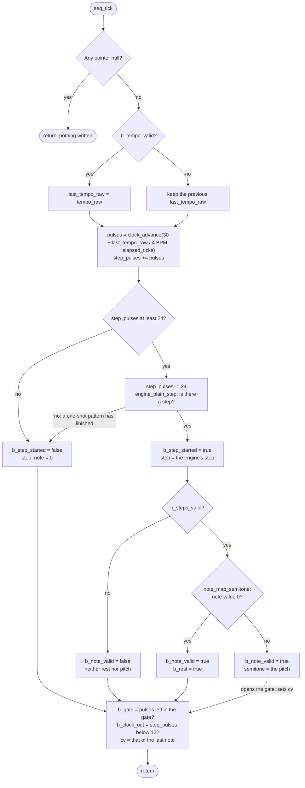

The chart is the path of a pattern running on the internal clock. It leaves out the transport, which comes first (a stopped pattern goes straight to the last box with the gate and clock output low), and the external clock, where `clock_follow()` stands in place of `clock_advance()` and the reading is a ratio. It also leaves out reset: when `b_reset` is set, the engine is sent back to the start of its pattern before the clock is advanced, on every tick, and that has no output of its own. It also draws the gate loosely: every step that falls due ends the gate before it, and only the pitch branch opens a new one. And `engine_plain_step` stands for whichever engine the mode switches choose.

### The engines and the engine interface

An engine decides what each step of the pattern is. The sequencer owns the clock and says when a step is due; the engine says which step it is, what note value it holds, and whether the note is tied to the step after it. Every engine has a state type, an init function that doubles as its reset, and a step function taking the same `engine_inputs_t` (the panel bits and the addressing controls) and filling in the same `engine_step_t` (a step number, a note value and a tie flag). `core/engine.h` holds those two types and describes the pattern.

`seq.c` chooses between the engines with a `switch` on the mode switches' number (see "Which engine" above); there is no table of function pointers. Each engine's state is kept in the sequencer's, side by side: together they are 21 bytes, and a union would save 16 of them at the price of a rule to deviate from. The engines are given one more thing, a pointer to the sequencer's random number generator, which the two that leave something to chance draw from.

`engine_plain` is the first and simplest: it asks the addressing for the next step and reads that step's four switches as the note value. Its state is the addressing state and nothing else, and it ties nothing.

### The stage engine

`engine_stage` reads the panel as eight stages, in the manner of the RYK M185. The first eight steps are the stages' note values. The second eight are their controls, step 8 for stage 0 and so on:

| Switches of the control | Meaning |
|---|---|
| Low two | The stage's length: 1 to 4 steps (the switches as a number, plus one) |
| High two | The gate mode: 0 single, 1 repeat, 2 hold, 3 rest |

- **Single**: the note plays on the stage's first step, and the rest of its steps are rests.
- **Repeat**: the note plays again on every step of the stage.
- **Hold**: the note plays once and lasts the whole stage. Every step but the last is tied to the one after it, so the gate closes only in the last step, when the gate length says.
- **Rest**: every step of the stage is a rest.

With the second eight steps all off, every stage is one step with its note, which is a plain pattern of eight steps. A stage whose note value is 0 is a rest in any mode. A pattern is from 8 to 32 steps long.

The engine is asked once for each step, like any other, and gives the stage's own number (0 to 7) each time, so a stage of three steps is logged three times. A silent step of a stage is an ordinary rest (note value 0), and a held one an ordinary note with the tie flag set: the sequencer needs to know nothing about stages. The stage's length is read when its first step is asked for and holds until its last; its note value and gate mode are read on every step, as they are then.

The stages are played in the order the addressing controls set, with the first and last step each taken as a stage (15 is stage 7, and so on round). A first stage above the last runs round through stage 7, as a range of steps does through step 15. The engine does this by handing the addressing a range within 0 to 15 and folding the step it gets back into 0 to 7, so direction, pendulum and one-shot all work as they do for the plain engine, with a cycle being once through the stages.

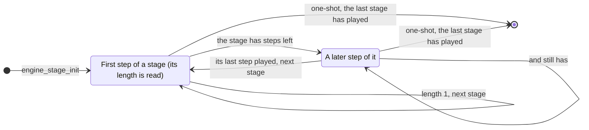

### Addressing

`address_next()` gives the step to play and moves on. The controls are a direction, a first and a last step, and a one-shot flag:

- **The range** is the steps from the first to the last. If the first is the higher of the two, the range runs through step 15 and round to step 0 (first 14, last 1 is steps 14, 15, 0, 1), so every pair of settings is a valid range of 1 to 16 steps.
- **A cycle** is one pass over the range: first to last going forward, last to first in reverse, and out and back as a pendulum with each end played once (0 1 2 3 2 1, then 0 again).
- **One-shot** stops after one cycle; `address_next()` then returns false until `address_init()` (the reset) or until one-shot is cleared.
- **The state** is how many steps of the cycle have been played, not a step number. That makes reset the same in every direction (the count goes to 0) and the end of a cycle one comparison. The cost is that a change of direction or range in the middle of a cycle carries the count over, so the pattern jumps to the matching point of the new cycle and does not turn round where it stands. A count beyond the end of a shortened cycle starts the cycle again.

Forward over the whole panel, which is what the firmware plays today, goes round like this:

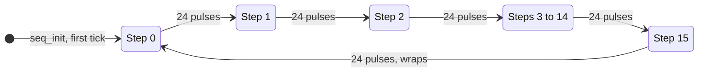

### The Klee engine

`engine_klee` is after the Klee sequencer: not a step that moves along the panel but a pattern of bits going round a sixteen-stage shift register, with every active stage adding its value to the note.

- **The panel.** Each step is a stage. Its highest switch is its pattern switch and its low three are its value, 0 to 7.
- **Load.** A load copies the sixteen pattern switches into the register. The first step after a start, a reset or a change of engine is a load, and so is the step after mode switch 3 is moved, either way. The pattern switches are read at no other time.
- **Moving.** Every other step moves the register on one stage, the bit leaving stage 15 coming round into stage 0.
- **The note** is the sum of the values of the active stages, read as they are on that step, limited to 15. A sum of 0 is a rest. One active bit plays the values in turn; two or more play sums that repeat every sixteen steps.
- **Invert** (mode switch 4) turns the bit over as it comes round, so the pattern comes back upside down after sixteen steps and as it was after thirty-two. A register loaded with nothing fills with ones.
- **Merge** (mode switch 5) ties every note to the step after it, so notes on consecutive steps are one gate and a rest ends it.
- **Chance** (mode switches 6 and 7, as a number 0 to 3) is how many times in eight the bit coming round is turned over at random. At 0 the pattern is locked; above it the pattern drifts, as a Turing Machine's does, and a load puts it back. It is counted on top of invert.
- **The step given** is how many times the register has moved since the last load, 0 to 15. The addressing controls are not used.

The engine has no gate buses: there is one gate output, and it opens for every step whose sum is not 0.

### The chance, Cartesian and Euclidean engines

Three small engines, each the plain engine with one thing changed.

- **`engine_chance`** plays the plain engine's steps and leaves two things to chance. Mode switches 3 and 4, as a number 0 to 3, are how many times in four a step is turned into a rest. Mode switch 5 picks each step at random from the range in place of the next in order; the addressing still counts the cycle, so a one-shot pattern ends after as many steps as the range has.
- **`engine_cartesian`** reads the sixteen steps as a grid of four by four and plays the one at column x of row y. Each counter moves on, round from 3 to 0, every so many steps: x every 1, 2, 3 or 4 (mode switches 3 and 4, plus one) and y every 4, 3, 2 or 1 (mode switches 5 and 6, taken from four). With all four off that is the sixteen steps in order; with y moving on every step it is the diagonal 0, 5, 10, 15; other settings trace longer paths. The addressing controls are not used.
- **`engine_euclid`** plays the plain engine's steps and counts a bar of sixteen beside them. Mode switches 3 to 6, as a number plus one, are the beats in the bar, 1 to 16, spread as evenly as sixteen steps allow (step k of the bar is a beat if k times the beats, modulo 16, is less than the beats). A step that falls on a beat sounds and any other is a rest. Sixteen beats is the plain engine.

### Random numbers

`prng` is a 16-bit linear feedback shift register (taps 0xB400), which goes through all 65535 non-zero values before repeating; `prng_byte()` shifts it eight times and gives the bits that came out. The sequencer owns the one generator, seeds it in `seq_init()` with a fixed number and hands the engines a pointer to it. So the "random" choices are the same after every power-on, and a reset or a start does not begin them again. Seeding it from something that differs between power-ons (the time to the first clock edge, or the low bits of the tempo reading) would be a few lines in the sequencer.

### The gate

The gate says how long a note is held. Its one control is a length in clock pulses, read when the step begins, so it scales with the tempo: 12 pulses is half a step at any speed.

- `gate_begin()` marks a step boundary. It ends whatever gate was open, and if a note begins there it opens a new one of that length.
- `gate_advance()` takes the pulses that have passed and gives the level: open until as many pulses as the length have gone by.

The sequencer calls both on a tick that begins a step, in that order, and looks at the level only afterwards. That is where ties come from, with no special case: a gate of a whole step (24 pulses) would close on the very pulse the next step begins on, and the next note has already reopened it by the time the level is read. So a length of 24 or more runs consecutive notes into one long gate, a rest in between still ends it, and anything shorter closes for at least one pulse (2.2 ms at the fastest tempo) before the next note. A length of 0 never opens the gate.

When a step begins late, after a stall, its gate is counted from when the step was due, not from when it was noticed, so the note still ends on time; if the whole gate has already gone by, it does not open.

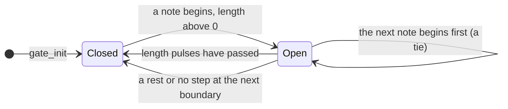

The length is one setting for the whole pattern, and the board has no control for it: the app fixes it at half a step. A tie for a single step comes from the engine: the sequencer gives a tied note a length of a whole step if the setting is shorter, and the arithmetic above does the rest. The stage engine's hold mode is built from that.

### Pitch calibration

`pitch_cal_cv()` turns a pitch in semitones into the value to send to the pitch CV output: a number from 0 to 4095. The core does not say what that is in volts; the app sends it to the `cv` port, whose unit is nominal millivolts.

The table has five entries, the CV value of each octave of the lowest pitch: semitones 0, 12, 24, 36 and 48. A pitch between two entries is put on the straight line between them and rounded to the nearest value. That shape is for calibration: a real DAC and buffer are a little off in gain and offset and not quite straight, and measuring the output at each octave and storing what gives exactly 1 V, 2 V and so on corrects all three, with the semitones in between following. Calibration mode, below, is how the entries are measured, and the record after it how they are kept. Until a table has been stored the app supplies the ideal one, 0, 1000, 2000, 3000, 4000, which is 83.33 a semitone: no pitch is more than half a millivolt (0.6 cents) from where the arithmetic puts it.

The entries need not rise, so an output stage that inverts is only a different table. An entry above 4095 is treated as 4095, and a pitch above 48 gives the last entry. The highest pitch the note mapping produces is 45, which is 3750.

### Calibration mode

`cal_tick()` turns the panel and the tempo pot into a way of setting the table against a voltmeter, with no other hardware. It is called on every tick, ahead of the sequencer.

**Getting in.** The mode is chosen once, on the first tick after `cal_init()`, from the panel as it is then read: it is entered if the last four steps read 10, 5, 10, 5, which is their switches set alternately like a chequerboard (steps 12 and 14: on, off, on, off from the most significant switch; steps 13 and 15: off, on, off, on). Any other panel plays as normal, and so does a panel that could not be read on that tick. From then on the choice stands until the next `cal_init()`, which on the board means until the power is cycled: setting the pattern while a sequence is playing does nothing, and leaving calibration is switching off, setting an ordinary pattern, and switching on.

**In the mode** nothing is sequenced: no step begins, nothing is logged per step, and the clock output stays low. The pitch CV is held at one point of the table so that it can be measured.

| Control | Does |
|---|---|
| The first step's switches, read as a number | Choose the point, 0 to 4: the voltage for that many octaves above the lowest pitch. A higher number is point 4 |
| The tempo pot | Trims the voltage: at its middle the output is the point's nominal value (n × 1000 mV), and its travel covers 64 mV below that to 63 mV above, 1 mV for every 8 counts of the reading. Point 0 cannot go below 0 |
| The lowest switch of the last step | Switching it on stores the voltage being given as the chosen point. It is on when the mode is entered, as part of the pattern, so it is switched off and on again |
| The gate output | High, so that whatever is patched to it sounds. It goes low for 250 ms after each store, to show that the store happened |

So calibrating one point is: set its number on the first step, turn the pot until the meter (or a tuner on the oscillator) reads exactly that many volts, and flip the store switch off and on. Only a stored point changes the table; the other four keep what they held, whether that was loaded from the EEPROM or the ideal value.

The nominal value of an octave is an input (`cv_per_octave`), which the app sets to 1000, so the core still does not know what a CV value is in volts. A panel read that fails leaves the point where it was and stores nothing; a pot read that fails leaves the trim where it was, and before the first reading the trim is at its middle.

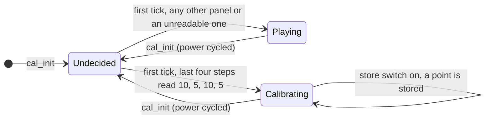

The pot has no hysteresis, so where a reading sits on the boundary between two values the output can flicker by 1 mV (1.2 cents), and whichever it is when the switch goes on is what is stored. Whether that is steady enough in practice is for the board to show (open item 11).

### The calibration record

`cal_record_encode()` and `cal_record_decode()` turn the table into the twelve bytes that are stored, and back:

| Bytes | Hold |
|---|---|
| 0 | The version of this layout: 1 |
| 1 to 10 | The five entries, lowest octave first, each as 16 bits with the low byte first |
| 11 | A checksum of bytes 0 to 10: CRC-8 with the polynomial 0x07, starting from 0, worked out a bit at a time so that it needs no table |

`cal_record_decode()` hands the table over only if the version is 1 and the checksum matches; otherwise it reports false and leaves the caller's table as it was, which is how the ideal table survives when nothing valid is stored. An EEPROM that has never been written reads as all ones, which is the wrong version. Any single wrong bit fails the checksum, and so does a record whose write was cut off part way. A record of another version is refused even if its checksum is right, so a future change of layout cannot be misread by this firmware or the other way round.

There is one copy. If the power goes while a record is being written, the next start finds a bad checksum and falls back to the ideal table: the whole calibration is lost, not just the point being stored (see the roadmap, decision 53).

### The panel

`panel_step_value()` picks one step's four switches out of the raw bytes. The steps' 64 bits are packed MSB first, 4 bits per step: step 0 is the high nibble of byte 0, step 1 the low nibble, step 2 the high nibble of byte 1, and so on. Every engine reads the same bits through this function and gives them its own meaning. `panel_mode_value()` gives the ninth byte as it is: the eight mode switches, a bit each. The sequencer uses the low three to choose the engine, and the engine chosen reads what it wants of the other five.

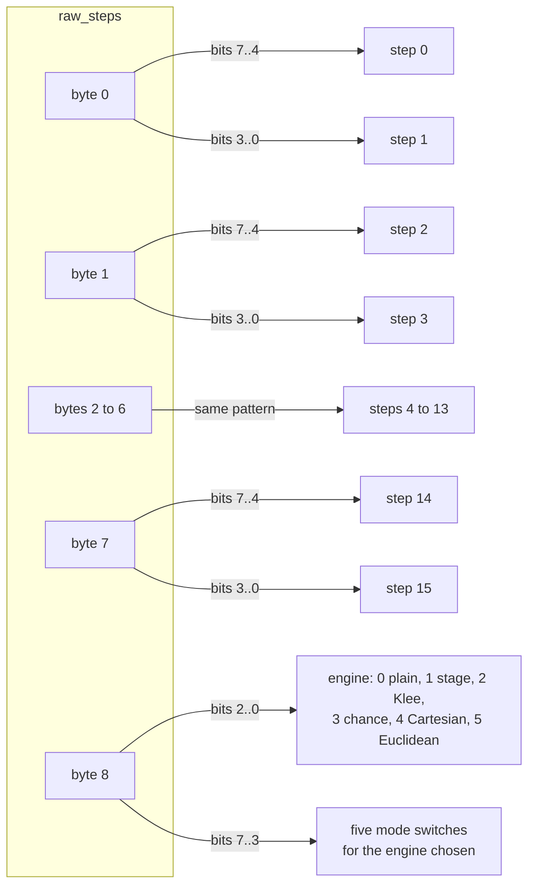

### Note mapping

`note_map_semitone()` turns a note value into a pitch. A value of 0 is a rest. Values 1 to 15 are the first fifteen notes of a scale, counting up from the root and carrying on into the next octaves: in a major scale 1 is the root, 8 the root an octave up, and 15 the root two octaves up. A pitch is a count of semitones above the lowest one the sequencer plays (note value 1 with a root of 0), from 0 to 45.

| Scale | Semitones above the root | Pitch of note values 1 to 15, root 0 |
|---|---|---|
| Chromatic | every one | 0 to 14 |
| Major | 0 2 4 5 7 9 11 | 0 to 24 |
| Natural minor | 0 2 3 5 7 8 10 | 0 to 24 |
| Major pentatonic | 0 2 4 7 9 | 0 to 33 |
| Minor pentatonic | 0 3 5 7 10 | 0 to 34 |

The root adds 0 to 11 semitones. There is no octave control yet. The DAC's 4.095 V covers the 0 to 45 semitones here (3.75 V) with a third of a volt to spare, so an octave control would need the output stage to add gain or an offset. The scale tables are 51 bytes of constant data, which this toolchain keeps in RAM as well as flash; keeping them in flash only would take a compiler extension, which the core does not use.

## Target adapters — `adapters/target/`

### Register map — `atmega328p_regs.h` and `atmega328p_regs.ld`

Each register is declared as an ordinary variable, for example `extern volatile uint8_t PORTD;`, with no address in the C source. The linker places each name at its datasheet address using `atmega328p_regs.ld`, which the Makefile passes as an extra linker input. A register must appear in both files; one missing from the `.ld` file fails at link time with an undefined reference, but a wrong address there links silently.

The USART0 registers and their bit positions are declared in a second header, `atmega328p_usart_regs.h`, on the same scheme and with their addresses in the same `.ld` file. Only `serial_logger.c` includes it. The release build does not link that file, so with the bit positions in the main header they would be macros nothing in the release firmware uses (MISRA rule 2.5). The Timer/Counter2 registers have a header of their own in the same way, `atmega328p_timer2_regs.h`, which also names the interrupt vector and the attribute that makes a function its handler. The SPI registers are in `atmega328p_spi_regs.h`, included only by `spi.c`, and the EEPROM registers in `atmega328p_eeprom_regs.h`, included only by `eeprom.c`. The four Timer/Counter1 registers the clock input needs are in `atmega328p_timer1_regs.h`, included only by `clock_input.c`, and the three external interrupt registers the reset input needs in `atmega328p_extint_regs.h`, included only by `reset_input.c`. The status register `SREG` and the reset flags register `MCUSR` are in the main header.

Registers in the low I/O range carry avr-gcc's `io_low` attribute, which lets the compiler keep using single-instruction bit operations (`sbi`, `cbi`, `sbis`) even though it cannot see the address. The generated code is identical to the earlier pointer-cast form. `ADC` is a 16-bit variable at 0x78, which reads ADCL then ADCH.

### Pin and ADC setup — `register_init.c`

| Pin | Nano label | Direction | Used for |
|---|---|---|---|
| PB0 | D8 (ICP1) | input, pull-up on | Clock input, from its jack through a transistor that pulls the pin low while the jack is high. A falling edge here is latched by Timer/Counter1's capture flag |
| PB1 | D9 | output, idle high | 74HC165 SH/LD (load, active low) |
| PB2 | D10 (SS) | output, idle high | MCP4822 chip select (active low). It must not be a low input, or the SPI leaves master mode. Set up by `spi.c`, driven by `cv_output.c` |
| PB3 | D11 (MOSI) | output | MCP4822 SDI (data in). Set by `spi.c` |
| PB4 | D12 (MISO) | input | 74HC165 serial data (QH of nearest chip), through 1 kΩ |
| PB5 | D13 (SCK, on-board LED) | output | 74HC165 CLK and MCP4822 SCK. Set by `spi.c`. The LED glows faintly: the bus is busy for 16 clocks every millisecond |
| PC0 | A0 | input | Nothing yet; never read |
| PC1 | A1 | output | Nothing yet; never written |
| PD2 | D2 (INT0) | input, pull-up on | Reset input, through the same kind of transistor stage. A falling edge here is latched by the flag of external interrupt 0 |
| PD3 | D3 | input, pull-up on | Sync switch, to ground: low while on |
| PD4 | D4 | output, idle low | Gate output: high while a note is held |
| PD5 | D5 | output, idle low | Clock output: high for the first half of each step |
| PD6 | D6 | input (as at reset) | Free |
| PD7 | D7 | input, pull-up on | Run button, to ground: low while pressed |
| ADC6 | A6 | analog | Tempo pot |

`register_init.c` sets PC0, PC1, the load line, the two outputs on port D and the four inputs. The load line is set high before it is made an output, so it is never driven low on the way; the gate and clock outputs are set low first for the same reason. The four inputs are made inputs and their pull-ups switched on. The SPI driver sets its own three pins.

The 1 kΩ in the MISO line is there because PB3 to PB5 are also the pins an ISP programmer uses: it lets the programmer win against the chain's output. It is not needed for the serial bootloader.

The ADC is enabled with a prescaler of 128, giving a 125 kHz ADC clock from 16 MHz. A normal conversion takes 13 ADC clocks, about 104 µs.

### Tempo input — `analog_reader.c`

Writes `ADMUX` with AVcc as the reference and channel 6, sets `ADSC` to start a single conversion, polls until the hardware clears `ADSC`, then copies out the 10-bit result. The wait is bounded: after 10000 polls (a few milliseconds, against a worst-case conversion of about 200 µs) it returns `ERR_TIMEOUT`.

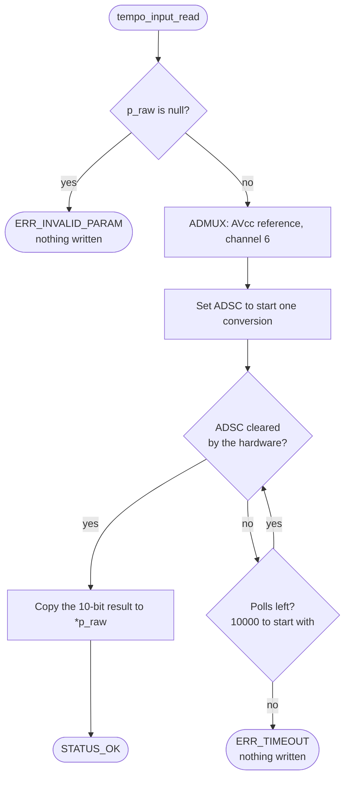

### SPI bus — `spi.c`

The first of the peripheral drivers: code that runs a part of the MCU for the device adapters above it and implements no port itself. Its header, `spi.h`, is private to `adapters/target/`.

`spi_init()` sets PB2 (SS) high and then makes it an output, makes PB3 (MOSI) and PB5 (SCK) outputs, and switches the SPI on as master: mode 0 (clock idle low, data sampled on the rising edge), most significant bit first, system clock divided by 16, which is 1 MHz. It writes both control registers in full, so nothing a bootloader left behind survives. The order matters: SS is an output before master mode is selected, because a low level on SS as an input cancels master mode. As an output the pin is free for other use, and it is the DAC's chip select; the driver leaves it high, which is that part's idle level.

`spi_transfer(tx, p_rx)` writes one byte to the data register, which starts eight clocks, polls for the transfer-complete flag, and reads back the byte that came in. A transfer takes 8 µs. The wait is bounded at 255 polls, well over ten times that, after which it returns `ERR_TIMEOUT`; that can only happen if the SPI is not enabled as master.

### Step input — `shift_reg_reader.c`

Pulses PB1 low then high to latch all parallel inputs, then makes one SPI transfer per byte, sending zeros. A 74HC165 has its first bit on QH as soon as it is loaded and moves to the next on each rising clock edge. SPI mode 0 samples on that same rising edge, so it takes each bit just before the chain moves on, and eight clocks leave the next byte's first bit waiting. Bits arrive MSB first, which fixes the wiring-to-step mapping:

| | Bits 7..4 | Bits 3..0 |
|---|---|---|
| 74HC165 inputs | H G F E | D C B A |
| Chips 0 to 7 (0 = nearest the MCU): chip `k` | step `2k` | step `2k + 1` |
| Chip 8, the farthest | mode switches 7 to 4 | mode switches 3 to 0 |

Within each nibble the higher-lettered input is the more significant bit, so input H of the nearest chip is the MSB of step 0. On chip 8 inputs A, B and C are the three switches that choose the engine, A being the lowest bit. Each chip's Clock Inhibit pin must be tied to GND. The load pulse is a single `cbi`/`sbi` pair, about 125 ns wide at 16 MHz, comfortably above the 74HC165's minimum at 5 V; the clock is 1 MHz, far below the chip's limit.

**The step lights** are written by the same function, because they share its bus and its control line. Two 74HC595s take their data from MOSI, the far one from the near one's serial output, on the same clock. They have no chip select, so every byte sent on the bus goes through them, the DAC's frames included; what they show is what they hold at the moment their latch clock rises, and that input is wired to PB1. `led_output_write()` therefore only keeps the sixteen bits. The next read sends them as two bytes (steps 15 to 8, then 7 to 0) ahead of the load pulse, and the rising edge that ends the pulse puts them on the outputs: step 0 on QA of the near chip, step 15 on QH of the far one. Whatever passes through afterwards is never latched, since the next rising edge of PB1 comes only after the next read has sent the lights again. So the lights change once a scan, up to 8 ms after the tick that set them, and cost two more transfers (16 µs) per scan and no pin. If the two bytes cannot be sent there is no load pulse and the read fails, so half-sent lights are never shown. That one pin can serve as load for the 74HC165s and latch for the 74HC595s has not been tried on hardware (open item 14).

The bytes are read into a buffer inside the function and copied out only if every transfer succeeded, so a read that fails part way leaves the caller's data as it was.

Sampling on the edge that also shifts relies on the chain's output not changing until a little after the edge. That is how a 74HC165 is normally read over SPI, and the MCU samples at the instant it drives the clock, but it is a timing margin the emulator cannot show: it has to be confirmed on the board (open item 8).

The chain, with data moving right to left towards the MCU. Chip 0's bits arrive first and land in byte 0:

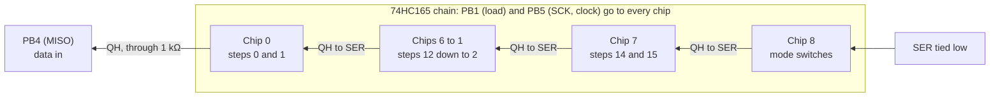

One read, as the pulses the MCU sends and the bits it gets back. The SPI hardware does the inner loop; the code sees one transfer per byte:

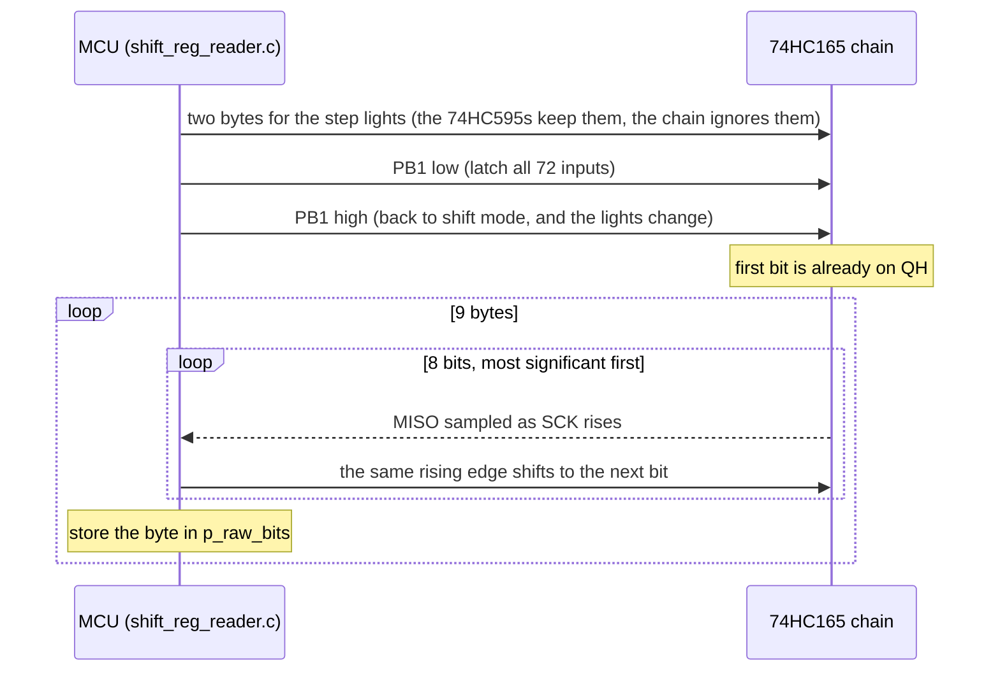

### Pitch CV output — `cv_output.c`

The second device adapter on the SPI driver: it implements the `cv` port on channel A of an MCP4822, a two-channel 12-bit DAC with its own 2.048 V reference. The reference is the reason for the part: the pitch does not move with the USB 5 V rail, as it would from a DAC referred to its supply.

`cv_output_write(millivolts)` takes PB2 low, sends two bytes, and takes PB2 high again. The sixteen bits are four of configuration (channel A, a gain of 2, output on: `0001`) and then the twelve of the value, most significant first. At a gain of 2 the full range is 4.096 V over 4096 steps, so one step is 1 mV and the value sent is the voltage asked for. With the DAC's LDAC pin tied low, the output changes as PB2 rises. A value above 4095 is refused with `ERR_INVALID_PARAM` and nothing is sent.

If either transfer times out, the status is returned and PB2 is raised all the same. The DAC ignores a frame cut short of sixteen clocks, so a failed write leaves the output where it was, and the next tick tries again.

The write takes 20 µs with PB2 low, and happens every millisecond. The 74HC165 chain is on the same clock and has no chip select, so those sixteen clocks shift it as well. That does no harm: the chain is loaded afresh before each read and its output is ignored in between.

How the part is wired (PDIP-8 pin numbers):

| MCP4822 pin | Goes to |
|---|---|
| 1 VDD | 5 V, with 100 nF to ground close to the pin |
| 2 CS | D10 (PB2) |
| 3 SCK | D13 (PB5) |
| 4 SDI | D11 (PB3) |
| 5 LDAC | Ground |
| 6 VOUTB | Not used |
| 7 VSS | Ground |
| 8 VOUTA | The pitch CV |

The pin numbers and the frame layout have been checked against the datasheet (DS20002249B, table 3-1 and register 5-1). VOUTA can drive a high-impedance input directly for a first test. The roadmap's op-amp buffer goes between it and the jack.

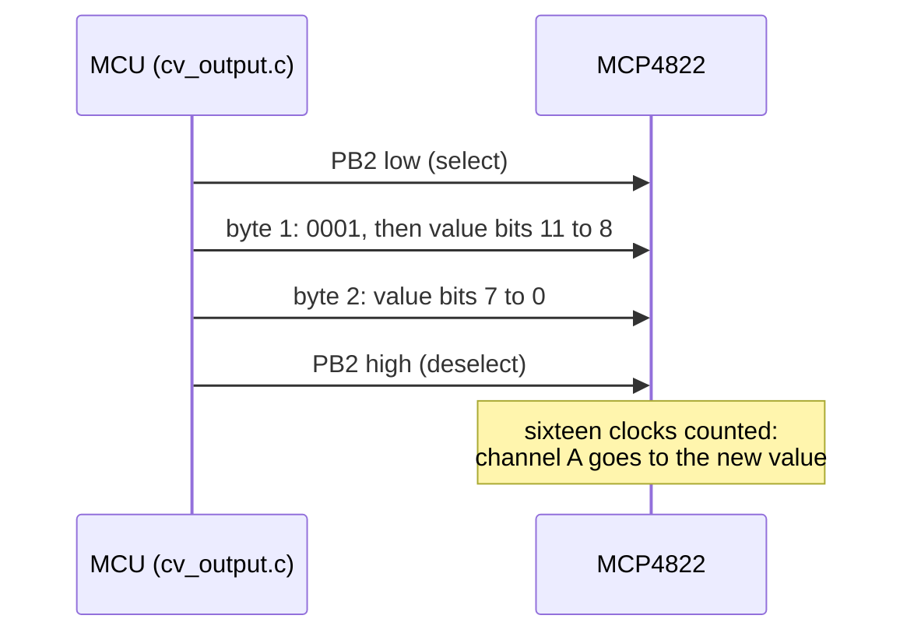

### Gate and clock outputs — `gate_output.c`, `clock_output.c`

Each is one function that drives one pin of port D high or low: `gate_output_write()` PD4 and `clock_output_write()` PD5. Either level is a single `sbi` or `cbi` instruction, so nothing else on the port is disturbed and nothing needs masking. The app calls both on every tick with the level the pin should have; writing the level a pin already has does nothing. The pins are made outputs, low, by `register_init.c`.

These are bare logic pins, 0 V and 5 V, good for about 20 mA. That is enough for a logic analyser or an LED through a resistor, and many gate inputs will take it, but nothing protects the pin from what is plugged into it. The roadmap's buffer stage goes between these pins and the jacks.

### Clock and reset inputs — `clock_input.c`, `reset_input.c`

Each implements a port with one function, which says whether an edge has arrived at its jack since it was last asked. The app asks once a tick, and a pulse can be far shorter than a tick, so reading the pin would miss it. Both use a flag that the MCU sets on an edge and keeps until it is cleared:

| | Clock input | Reset input |
|---|---|---|
| Pin | PB0, the input capture pin of Timer/Counter1 | PD2, the pin of external interrupt 0 |
| Flag | ICF1 in `TIFR1` | INTF0 in `EIFR` |
| Set up by | `clock_input_init()`: the timer counting the system clock divided by 8, capture on the falling edge, the noise canceller on, every timer interrupt off | `reset_input_init()`: the flag set by a falling edge, both external interrupts off |
| Then | The flag is cleared, in case choosing the edge set it | The same |

`clock_input_edge()` and `reset_input_edge()` test their flag and, if it is set, clear it by writing a one to it, which is how these flags are cleared; the zeros written to the other bits of the register leave them alone. The test is one instruction and the clear two. An edge that arrives between the test and the clear is taken as the same edge.

No interrupt is used: nothing has to happen at the instant of the edge, only by the next tick, so the flags are polled and the interrupts they belong to stay off. Leaving them off matters, because neither vector has a handler and an enabled one would restart the firmware. The timer's count is not read either. It is running so that the capture works as the datasheet describes it, and the captured value would give an edge's time to half a microsecond if a later phase wanted it.

The edge is the falling one at the pin because of what is meant to sit between jack and pin: a transistor with its collector on the pin, which pulls the pin low while the jack is high, so that the jack's rising edge is the pin's falling one and nothing outside can put more than 5 V on the MCU. That stage is not designed in detail or built, and the pin's own pull-up is all that holds it high. If the stage turns out not to invert, the edge is one bit in each init function.

Two things here rest on the datasheet alone (open item 12): that these flags are set while their interrupts are off, and that the capture needs nothing more than this. The emulator had no model of either, so the one it uses now was written for this project and proves only that the firmware does what was intended.

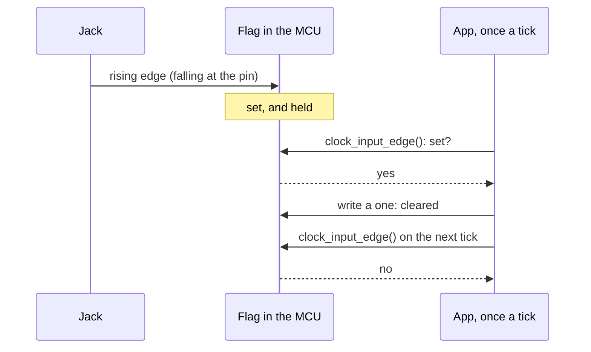

### Run button and sync switch — `run_input.c`, `sync_input.c`

Each is one function that reads one pin of port D: `run_input_read()` PD7 and `sync_input_read()` PD3. The button and the switch connect their pin to ground when closed, with the pin's pull-up holding it high otherwise, so a low pin reads as true. Nothing is debounced here; the core does that, from readings taken every millisecond.

### Non-volatile storage — `eeprom.c`

Implements the `nv` port on the MCU's own EEPROM: 1024 bytes that keep their contents with the power off. The firmware uses the first twelve, for the calibration record. It is one file, like the timebase: the peripheral has a single user, so there is no separate driver under it.

Reading is quick and writing is slow, and the three functions are shaped by that:

- `nv_read()` sets the address, strobes the read bit and takes the byte from the data register, once per byte. A byte costs a couple of microseconds, so the twelve of the record are read in one call at start-up. It refuses with `ERR_BUSY` while a write is going on, because it would move the address register under it.
- `nv_write()` does not touch the EEPROM. It copies up to 16 bytes into a buffer of its own and returns. A second call while bytes of the first are still waiting is refused with `ERR_BUSY`.
- `nv_poll()`, called on every pass of the main loop, deals with one byte and returns: nothing, if there is nothing waiting or the EEPROM is still busy with the byte before. Otherwise it reads the byte now at that address and, only if it differs from the one wanted, starts writing it. A byte takes about 3.4 ms, during which the loop carries on.

Skipping the bytes that are already right is what makes storing one calibration point cheap: over an existing record only the entry that changed and the checksum differ, two or three bytes, where a first write to an erased EEPROM is up to twelve (about 40 ms). It also saves wear (the datasheet's figure, from memory, is 100,000 writes a byte, as the 3.4 ms is its typical write time).

Starting a byte is a timed sequence. Setting the write enable bit only works within four clock cycles of setting the master write enable bit, so that a stray write to the register cannot corrupt the EEPROM. The two are done by consecutive instructions (an `out` and an `sbi`), and interrupts are switched off around just those two and put back as they were, so that the tick interrupt cannot land between them. That holds the tick off for a few clock cycles at most, once per byte written.

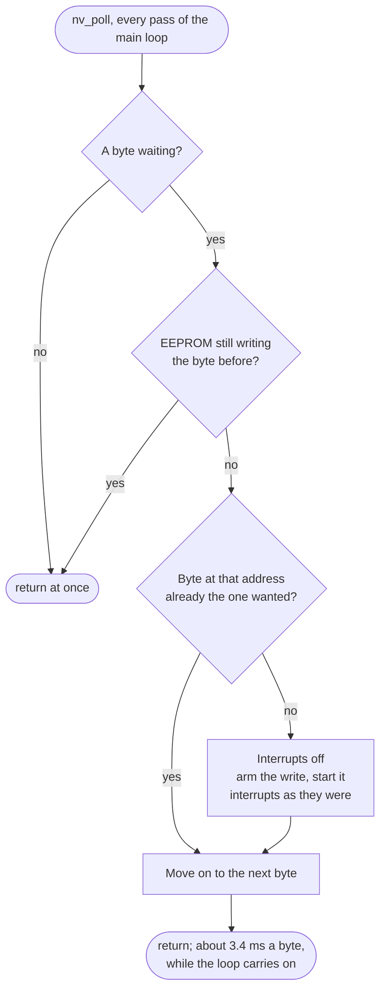

Nothing reports that a write has finished, and nothing reads back what was written: the record's checksum is the check, at the next start. The addresses and bit positions were checked against the toolchain's own header, and the timed sequence against the disassembly and on the emulated board; the part itself has not been written on the real one (open item 11).

Two things outside the firmware can wipe the EEPROM: a chip erase by an ISP programmer (unless the EESAVE fuse is set), and loading another program that uses the same bytes. Uploading through the serial bootloader leaves it alone.

### Reset cause — `reset_cause.c`

Implements the `reset_cause` port. The MCU keeps a flag for each kind of reset in `MCUSR` and never clears them itself, so `reset_cause_read()` reads the low four bits and writes the register back to zero, so that the next start sees only its own cause. The bits are, from the lowest: power-on (1), the reset pin (2), brown-out (4), watchdog (8). More than one can be set. By the datasheet, switching the board on should show as a power-on reset and pressing its reset button as the reset pin alone.

The app reads it once, in `app_init()`, and the debug build logs it in the start-up line. Nothing acts on it yet; the crash log of the roadmap's phase 9 is what it is for. What it reads on this board depends on what the bootloader, which runs first, leaves in the register, and that has not been looked at (open item 11).

### Log — `serial_logger.c` (debug build)

`logger_init()` sets the baud divisor from `F_CPU` for 115200 baud in double-speed mode (`16000000 / (8 × 115200) − 1 = 16.4`, rounded to the nearest divisor, 16), sets double speed and 8N1 explicitly, enables the transmitter and receiver, and empties the queue. Nothing reads from the UART.

A divisor of 16 gives 117647 baud, 2.1 % fast. That is the usual setting for 115200 on a 16 MHz AVR and what USB serial bridges are routinely run at, but it is not exact. Normal-speed mode cannot do better (its nearest divisor is 8.5 % off), which is why double speed is used. The rates that are exact at 16 MHz are 250000, 500000 and 1000000; changing `BAUD` in `serial_logger.c` is enough to switch, and the divisor follows from it.

Nothing in the logger waits for the UART. The port functions `log_step_note()`, `log_step_rest()`, `log_startup()`, `log_cal_point()`, `log_transport()` and `log_error()` own the message wording (`Step 3 Note = 11`, where the number is the pitch in semitones; `Step 5 Rest`; `Reset = 2 Cal = 1`, the reset flags as a number and whether a stored calibration is in use; `Cal point 2 = 2013`, a calibration point and the value stored for it; and `Transport = 2`, sent when the pattern stops (0), starts on the internal clock (1) or starts on, or changes to, the external one (2)). Each checks the log level, then writes the message in pieces, fixed text through `write_text()` and numbers through `write_decimal()` (unpadded decimal digits), into a 128-byte ring queue. `log_poll()`, called on every pass of the main loop, sends one queued byte if the transmit buffer is empty and otherwise returns at once. The level is set to DEBUG at init, so step notes (DEBUG), the start-up, calibration and transport lines (INFO) and errors (ERROR) all print.

A message that does not fit in what is left of the queue is dropped whole: the bytes of it already queued are taken back out, so a partial line is never sent. The queue holds the two longest messages together (53 characters each). The one case that overruns it is all three errors on the same step with nothing sent in between (133 characters), where the last, the pitch CV error, would be dropped. In normal running it never fills: the fastest tempo produces a 19-character line every 52.6 ms, and a line is gone in 1.6 ms.

`log_flush()` sends everything still queued and does wait. It is only used when initialization has failed and the main loop is not going to run.

```mermaid
flowchart TD
    call(["log_step_note, log_error<br/>or any other message"]) --> level{"Message level at or below<br/>the configured level?"}
    level -->|"no"| drop(["return, nothing queued"])
    level -->|"yes"| pieces["Write the message in pieces"]
    pieces --> text["write_text<br/>fixed wording"]
    pieces --> dec["write_decimal<br/>number as digits"]
    text --> ch["write_char"]
    dec --> ch
    ch --> room{"Room in the queue?"}
    room -->|"yes"| queue[("128-byte queue")]
    room -->|"no"| undo["Mark the message dropped;<br/>end_message takes its bytes back out"]
    poll(["log_poll, every pass of the main loop"]) --> any{"Anything queued<br/>and UDRE0 set?"}
    any -->|"no"| back(["return at once"])
    any -->|"yes"| udr["Move one byte from the queue to UDR0"]
    queue --> udr
    udr -->|"about 85 microseconds per byte"| wire(["PD1 to the USB serial chip"])
```

### Log — `null_logger.c` (release build)

The same nine functions (`logger_init()`, `log_step_note()`, `log_step_rest()`, `log_startup()`, `log_cal_point()`, `log_transport()`, `log_error()`, `log_poll()`, `log_flush()`) with empty bodies. It touches no registers, so the USART is never set up or enabled, and it keeps no state. The app still calls the log port; each call returns immediately.

### Timebase — `timebase.c`

`timebase_init()` sets Timer/Counter2 to count the system clock divided by 64 (250 kHz) and to start again from zero after 250 counts (clear-on-compare mode, compare value 249), which is exactly 1000 times a second. It enables the compare match A interrupt, then sets the global interrupt enable bit in the status register. It is the last step of `platform_init()`, so interrupts are only on once everything else is set up.

The interrupt handler adds one to a single-byte counter, `g_tick_count`, and returns: 10 instructions including saving and restoring the one register it uses. It is the only code that runs outside the main loop, and it never touches the core or a port.

`timebase_elapsed_ticks()` reads the counter, subtracts what it read last time, and remembers the new value. The counter is one byte, so the read is a single instruction and cannot be interrupted half way; no masking is needed. Because the result is a difference, a pass that arrives late is told how many ticks it missed, up to 255, and none are lost. The counter wrapping from 255 to 0 does not disturb the subtraction.

```mermaid
sequenceDiagram
    participant T as Timer/Counter2
    participant I as Interrupt handler
    participant L as Main loop (app_run_once)
    Note over T: counts 0 to 249 at 250 kHz
    T->>I: compare match, every 1 ms
    I->>I: g_tick_count + 1
    L->>L: timebase_elapsed_ticks(): 0, spin
    L->>L: timebase_elapsed_ticks(): 1, run a tick
    T->>I: compare match
    I->>I: g_tick_count + 1
    L->>L: timebase_elapsed_ticks(): 1, run a tick
```

## Host side — `adapters/host/` and `tests/`

`adapters/host/host_ports.c` implements every port for the PC. Tests script what the input ports return (data and status) and read back a record of every log call in order. The gate, the clock output, the pitch CV and the step lights are written on every tick, so they are not in that record: the fake keeps each one's level (or voltage) and counts the rising edges of the first two, and notes how long the record was and what the pitch CV was when the gate last rose. The non-volatile storage is 32 bytes of memory that a test can fill beforehand and read afterwards, and that survive the app being initialized again, as the EEPROM survives a power cycle; a write to it lands at once. The start-up log line is kept out of the event record too, so that the record of a run begins with its first step. The two edge inputs are each a pending edge that a test sets and the next read takes, as the hardware's flag is, and the button and the switch are levels a test sets. `make test` builds and runs thirty-seven programs with the PC compiler under `-std=c99 -pedantic -Wconversion -Wshadow -Werror`.

Nineteen link the code they test:

- `test_clock`: the clock alone. At a tempo: exactly BPM × 96 pulses in a minute across the tempo range, no drift over ten minutes, the same count whether ticks arrive singly or in batches, the remainder carried between pulses, the 300 BPM limit, a tempo of 0, and null-pointer handling. Following edges: the first edge bringing the caller's step due, whatever the ratio; before it, a step finished at the 20-tick rate and no further; exactly 24 pulses in every stretch for periods from 1 tick to 3999; pulses spaced by the measured period; the first stretch spaced as 20 ticks; a late edge waited for one pulse short; an early edge giving all that is left; each multiply, its limits, and its wait for a measured period; a divide of 2 and of 4 passing over edges, and a divide of 0; the ratio read at a sync edge and held; a gap of 4000 ticks not taken as a period, and one of 3999 taken; two edges with no time between; a stall giving no more than the stretch holds; running at a tempo ending the following; and null-pointer handling.
- `test_debounce`: the debounce alone. The first reading taken as it stands; a new level holding for exactly 20 ticks, each way; a bounce starting the count again; a short pulse ignored; elapsed ticks counted, a whole stall settling at once; no elapsed ticks changing nothing; and null-pointer handling.
- `test_transport`: the transport alone. The first tick a start on the internal clock, reported once; a switch on at power-on starting on the external clock; the switch choosing the clock once settled, as a change and not a start; a press stopping and the next starting; a held button and a bouncing one each being one press; a button held at power-on not being one; the switch doing nothing while stopped and counting at the start; elapsed ticks reaching the debounce; the power-on state; and null-pointer handling.
- `test_panel`: every step and nibble decodes from the right bits, a step number beyond the panel wraps, the mode switches are the ninth byte and no step reads it, and a null buffer reads as 0.
- `test_address`: each direction over the whole panel and over a range, pendulum cycles of 30, 2 and 1 steps, a range that runs round through step 0, one-shot in every direction, reset, clearing and setting one-shot mid-cycle, a direction or range changed mid-cycle, out-of-range settings, and null-pointer handling.
- `test_note_map`: the rest, the pitch of all fifteen note values in each of the five scales, every root in every scale, the highest pitch, out-of-range notes, roots and scales, and null-pointer handling.
- `test_engine_plain`: steps in addressing order with their panel values and no tie, the panel read as it is when the step is asked for, a finished one-shot giving no step, reset, and null-pointer handling (the pattern does not move on).
- `test_engine_stage`: the stage engine alone. With every control off, eight stages of a step each, round and round; a stage lasting its length in steps; single playing the first step only; hold tying every step but the last, and a hold of one step tying nothing; rest playing nothing; a note value of 0 a rest in any mode; the length read once and the note and mode on every step; reverse, pendulum, a range that runs round through stage 7 and steps above 7 taken as stages; a finished one-shot giving no step after its last stage has played in full, and leaving the state as it was; reset; and null-pointer handling.
- `test_engine_klee`: the Klee engine alone. The first step loading the pattern switches; one bit going round playing each value; the sum under two bits, and a rest where it is 0; the sum limited to 15; values read on every step and the pattern only at a load; the load switch loading when moved either way, and not when left on or on from the start; invert filling the register and emptying it over thirty-two steps; chance turning the bit that often, for draws worked out from the generator's known bytes, cancelling against invert, and doing nothing at 0 or with no generator; merge tying every step; the other mode switches changing nothing; and null-pointer handling.
- `test_engine_chance`: the chance engine alone. With its switches off, the plain engine; one and three steps in four skipped, on exactly the steps the generator's bytes say; shuffle picking from the whole panel, a short range, a range that runs round and a range of one; nothing left to chance with no generator; a one-shot ending after a cycle with nothing drawn afterwards; and null-pointer handling.
- `test_engine_cartesian`: the Cartesian engine alone. With its switches off, the sixteen steps in order; x every second and every fourth step; y every third and every step; reset; and null-pointer handling.
- `test_engine_euclid`: the Euclidean engine alone. The beats for 1, 2, 4, 5, 8 and 16 to the bar, over two bars; every setting giving that many beats; the bar counted apart from a three-step pattern; a finished one-shot giving no step and moving nothing; reset; and null-pointer handling.
- `test_prng`: the generator alone. The seed taken, and 0 taken as 1; the first bytes from two seeds matching a sequence worked out in Python; back at the seed after exactly 65535 bytes, never at 0, with every byte value met 256 times (0 one fewer); and a null state giving 0.
- `test_gate`: the gate alone. Closed after init; open for exactly its length for a range of lengths; a length of 0; a rest; several pulses at once and more than were left; a shorter gate closing before the next note; a whole step tying three notes with the gate never seen closed; a longer length cut off by the next boundary, and a rest ending a tied note; the length read when the note begins; and null-pointer handling.
- `test_pitch_cal`: the calibration alone. Each octave gives its table entry; the ideal table gives a twelfth of an octave per semitone and is never more than half a value out; a pitch between two entries lies on the line between them, with a different slope in each octave; a falling table is followed downwards; a pitch above the table gives the last entry; an entry above the range is limited; the largest table does not overflow; and a null table gives 0.
- `test_cal_record`: the record alone. The exact twelve bytes for two tables, with checksums worked out separately (by a CRC-8 that gives the standard check value); every table read back as written; a record made elsewhere accepted; erased and all-zero storage refused; another version refused although its checksum is right; every one of the 96 single-bit errors refused; a write cut off after any number of bytes refused; the caller's table untouched by every refusal; and null-pointer handling.
- `test_cal`: calibration mode alone. An ordinary panel never enters it, even if the pattern appears later; the pattern on the first tick does, and it stays; each of the four pattern steps has to match and the other twelve are free; an unreadable panel, or none, plays as normal; the point follows step 0, with higher values limited; the trim is one value for every eight counts, to both ends of its range and no lower than 0; the trim at its middle until read and held through a failed read; the nominal octave taken from the input and the result limited; a store on the switch going on, once, of the value given, to the one entry; each point on its own, and only the lowest switch of step 15; nothing stored while the panel cannot be read; the gate low for exactly 250 ticks after a store, counted in elapsed ticks and restarted by a second store; a new init choosing afresh; and null-pointer handling.
- `test_seq`: the sequencer with the modules above linked in. The first tick begins step 0; step length for five tempos (exactly 15000 / BPM ticks, the first step included); 19 steps a second at the fastest setting; the steps in order with wrap; the pitch or rest of every step and nibble; the note taken from the tick its step begins on; a step beginning on time through a failed read; the tempo floor before any reading; last-valid-tempo reuse; independence of the two valid flags; batched ticks; steps owed after a stall; a rest; the scale and root applied; the addressing controls followed; a one-shot pattern stopping while the clock runs on; reset not moving the clock, held, and restarting a finished one-shot; the gate open for half of each of sixteen steps, to the tick; four other gate lengths; no gate for a rest or an unreadable step; tied notes and the rest that ends them; the gate length read when the step begins; a late step's gate counted from when it was due; the clock output high for the first half of every step, with or without a note, and through a finished one-shot; a reset not cutting a held note; the pitch CV set by each note on the tick its gate opens, through the scale and root; given on every tick and held after the gate closes; 0 until the first note; held through a rest, an unreadable step, a reset and a finished one-shot; the calibration table read when the step begins; and null-pointer handling. For the transport: the mode given on every tick; the run button stopping the pattern at once, with the gate cut, the clock output low and the pitch held; starting again from the first step, a whole step long; the time on the tick of a start not counted; a stopped pattern ignoring reset and the external clock; with the sync switch on, nothing until an edge and then a step on each, whatever the gap, and nothing when they stop; the external gate and clock output half the measured step, and 10 ticks for the first; all seven ratios at their boundaries, and a reading above the range; four steps to an edge 25 ticks apart; steps owed after an early edge beginning one per tick; a divided clock passing over edges; the last valid reading used as the ratio; going to the external clock mid-step finishing the step and waiting; going back carrying on; a reset on the external clock playing the first step at the next edge; a start on the external clock waiting for an edge; an early edge getting a tick with the gate and clock output low before its step, and the edge after it being on time; and a tied gate not being broken by edges that come on time. For the engines: the mode switches' low three bits choosing the stage engine at 1 and the plain one at every other number, whatever the other five switches say; the choice made from the last readable panel; a change of engine starting the new pattern from its beginning, each way; a reset sending the chosen engine back; a note the engine ties held into the next step as one gate, with the clock output still pulsing on every step; and a tie leaving a longer gate length alone. For the step lights: the light of each step lit for the first half of it and dark for the second, a rest included, round the pattern; nothing lit for a step of a finished one-shot or while stopped; and the Klee register shown. Mode 2 playing the Klee engine, its register back after sixteen steps and loaded again by a reset; modes 3, 4 and 5 playing the chance, Cartesian and Euclidean engines; and a reset not starting the random numbers again.
- `test_app`: the real `app.c` and core linked against the fakes, with time scripted. Checks that a pass with no tick only polls the log; that a step is logged one tick after it begins, once; that steps are logged at the tempo and wrap; that the gate and clock output go high one tick after their step begins and before its log line; that they are written on every tick and not between ticks; that the gate is held for half a step; that a rest has a clock pulse and no gate, and an unreadable step no gate; that re-initializing puts both low; that the pitch CV is written on every tick and not between ticks, is at the note's voltage before the gate goes high, follows the ideal table, holds through a rest and goes back to 0 V on re-initializing; that a failed write of it is logged once per step, after the note, and put right by the next tick; that a rest is logged as a rest; that all sixteen steps play forward in the chromatic scale; that the inputs are read on the first tick and every eighth after, counted in elapsed ticks; that a failed read logs the right error in the right place, once per step; and that init failure is logged, flushed and returned. For calibration: that init reads the reset cause once and reports it with whether a calibration was found, and does neither if the platform failed; that a stored record is loaded and played from; that an invalid one leaves the ideal table without an error, and a failed read leaves it with one; that the storage is polled on every pass; that the entry pattern at start-up gives the point's voltage and a high gate on the second tick, with no step, no clock pulse and no write; that the point and the trim follow the controls at the scan after they change; that a store starts one write of the whole record a tick after the scan that saw it, logs the point, and is not repeated; that the gate is then low for 250 ticks; that a stored point is played after the next init, and the other points of a loaded table are kept; that a write that cannot start is logged and can be done again; and that the pattern set after start-up, or behind a failed first read, is only a pattern. For the transport: that the run button stops the pattern a tick after its press counts and logs it, and starts it again from step 0 with the transport logged ahead of the step; that with the sync switch on the change is logged, no step begins, and each edge at the clock input is one step, taken on the next tick whether or not it is a scan tick; that an edge at the reset input sends the pattern back once; that a new init starts a stopped pattern running; and that calibration mode leaves all four inputs without effect. And that the mode switches reach the core with the panel read: with them set to 1 the log shows a two-step stage twice. And that the step lights are given on every tick and not between ticks, one tick after their step begins, go dark half a step later, and start dark after a new init.

The other eighteen `#include` the one source file they test, with `tests/fake_atmega328p_regs.h` standing in for the register map (it claims the include guards of all seven real register headers) and any function that file calls but does not define supplied as a stub by the test:

- `test_eeprom`: bytes read from the right addresses, to both ends of the EEPROM; erased bytes reading as ones; bad parameters refused without touching the hardware; a write doing nothing until polled, then one byte per poll, from its own copy of the data; each byte armed before it is started, with interrupts off for both and the status register given back as it was found; a poll returning at once while the byte before is still being written; a byte already there not written again; a second write refused until the first has gone; a read refused while bytes are waiting and while the hardware is still writing the last; the largest write, to the last byte of the EEPROM; and a poll with nothing to do not looking at the hardware. The fake EEPROM stores a byte only if the write was armed first and then shows it as in progress for a set number of polls.
- `test_reset_cause`: each of the sixteen combinations of flags reported in its own bits, the flags cleared by the read, other bits of the register left out, and nothing else touched.
- `test_clock_input` and `test_reset_input`: the set-up values, with stale bits cleared and every interrupt of the peripheral off; a flag latched before init forgotten, by one write of that flag alone made after the edge was chosen; no edge reading false and writing nothing; an edge reported once, and the next one again; the register's other flags neither read as an edge nor cleared; and no pin or other peripheral touched. The fake flag register keeps a flag set until a one is written to it, as the hardware does.
- `test_run_input` and `test_sync_input`: a low pin reads true and a high one false, whatever the rest of port D holds, and nothing is written.
- `test_serial_logger`: the USART setup values (divisor 16, double speed, 8N1), the level filter (now with the three info-level lines), that nothing is sent until polled, one byte per poll, nothing while the transmit buffer is full, message order, a message that does not fit being dropped whole, the queue wrapping, `log_flush()`, and that every message is byte-for-byte what a `printf`-style format string produces.
- `test_null_logger`: init succeeds at any level, every message is discarded, polling and flushing do nothing, and no USART register is written.
- `test_register_init`: which direction bits are set and cleared (the four inputs among the cleared), that their pull-ups are on, that the UART's pins keep their direction, that the load line idles high and was high before it became an output, that the gate and clock pins start low and were low before they became outputs, that other levels are left alone, and the ADC enable and prescaler value.
- `test_gate_output` and `test_clock_output`: high sets the one pin and low clears it, whatever the rest of port D holds, and no direction register or other port is touched.
- `test_cv_output`: the sixteen bits sent for a range of voltages (channel A, gain 2, output on, then the value), chip select low for both bytes and high after, every write a frame of its own, no other pin or direction touched, a failed first byte ending the frame there, a failed second byte returned, chip select released after either, and a voltage above the range refused without touching the bus. The SPI driver is a stub that records each byte and the state of chip select.
- `test_analog_reader`: channel and reference selection, the result, a slow conversion, the timeout at exactly the poll budget, and parameter checks. The fake ADC clears its start bit after a set number of polls.
- `test_spi`: the control register values (master, mode 0, 1 MHz) with stale bits cleared, the pin directions and levels (SS, MOSI and SCK outputs, MISO left an input), SS high before it is an output and an output before master mode, bytes sent and received, the complete flag cleared, a slow transfer, the timeout at exactly the poll budget and with the SPI never enabled, and the null check. The fake SPI completes a transfer after a set number of polls, and only if it is enabled as master.
- `test_shift_reg_reader`: every bit of the nine-chip chain lands in the right place, two bytes for the step lights sent first with the line idle (the high byte, then the low, and the latest given), then one load pulse and one transfer per byte of zeros, no load pulse if the lights could not be sent, the load line left idle, other port B pins and all of port D untouched, a failed transfer at each position returned with the caller's buffer left alone, and parameter checks. The SPI driver is a stub that clocks the fake's model of the 74HC165 chain, so a read only returns the right bytes if the load pulse comes first and the line is high while it reads.
- `test_init`: logger bring-up, then registers, then the SPI bus, then the clock and reset inputs, then the timebase; at DEBUG level; each failure returned, and the timebase (and so interrupts) not started after one.
- `test_timebase`: the Timer/Counter2 register values, that interrupts are enabled only after the timer is fully set up and without disturbing the other status bits, one tick per interrupt, ticks reported once, a late caller losing none up to 255, and the counter wrap. The fake header turns the interrupt handler into an ordinary function, which the test calls to make a tick happen.
- `test_main`: `main()` (renamed while included) returns the status when init fails and otherwise loops calling `app_run_once`. The stub leaves the endless loop with `longjmp`.

Which program tests which source file. Solid arrows link the real file; dotted arrows `#include` it against the fake registers. Each core program is linked with all of `core/`, so `test_seq` runs the real engine, addressing and note mapping under the sequencer:

```mermaid
flowchart LR
    t_seq["test_seq<br/>71 tests"] --> seq["core/seq.c"]
    t_tr["test_transport<br/>11 tests"] --> tr["core/transport.c"]
    t_db["test_debounce<br/>8 tests"] --> db["core/debounce.c"]
    t_cal["test_pitch_cal<br/>9 tests"] --> cal["core/pitch_cal.c"]
    t_calm["test_cal<br/>16 tests"] --> calm["core/cal.c"]
    t_rec["test_cal_record<br/>9 tests"] --> rec["core/cal_record.c"]
    t_gate["test_gate<br/>10 tests"] --> gate["core/gate.c"]
    t_clock["test_clock<br/>30 tests"] --> clock["core/clock.c"]
    t_engine["test_engine_plain<br/>6 tests"] --> engine["core/engine_plain.c"]
    t_stage["test_engine_stage<br/>11 tests"] --> stage["core/engine_stage.c"]
    t_klee["test_engine_klee<br/>13 tests"] --> klee["core/engine_klee.c"]
    t_chance["test_engine_chance<br/>7 tests"] --> chance["core/engine_chance.c"]
    t_cart["test_engine_cartesian<br/>6 tests"] --> cart["core/engine_cartesian.c"]
    t_euc["test_engine_euclid<br/>6 tests"] --> euc["core/engine_euclid.c"]
    t_prng["test_prng<br/>4 tests"] --> prng["core/prng.c"]
    t_address["test_address<br/>23 tests"] --> address["core/address.c"]
    t_note["test_note_map<br/>12 tests"] --> note["core/note_map.c"]
    t_panel["test_panel<br/>6 tests"] --> panel["core/panel.c"]
    t_app["test_app<br/>54 tests"] --> app["app/app.c"]
    t_app --> core["all of core/"]
    t_app --> hostp["adapters/host/host_ports.c"]
    t_main["test_main<br/>3 tests"] -.-> mainc["app/main.c"]
    t_ser["test_serial_logger<br/>21 tests"] -.-> ser["serial_logger.c"]
    t_cin["test_clock_input<br/>7 tests"] -.-> cin["clock_input.c"]
    t_rin["test_reset_input<br/>7 tests"] -.-> rin["reset_input.c"]
    t_run["test_run_input<br/>3 tests"] -.-> run["run_input.c"]
    t_syn["test_sync_input<br/>3 tests"] -.-> syn["sync_input.c"]
    t_ee["test_eeprom<br/>15 tests"] -.-> ee["eeprom.c"]
    t_rst["test_reset_cause<br/>4 tests"] -.-> rst["reset_cause.c"]
    t_null["test_null_logger<br/>3 tests"] -.-> nul["null_logger.c"]
    t_reg["test_register_init<br/>7 tests"] -.-> reg["register_init.c"]
    t_gout["test_gate_output<br/>3 tests"] -.-> gout["gate_output.c"]
    t_cout["test_clock_output<br/>3 tests"] -.-> cout["clock_output.c"]
    t_cv["test_cv_output<br/>7 tests"] -.-> cv["cv_output.c"]
    t_spi["test_spi<br/>9 tests"] -.-> spi["spi.c"]
    t_adc["test_analog_reader<br/>9 tests"] -.-> adc["analog_reader.c"]
    t_shift["test_shift_reg_reader<br/>10 tests"] -.-> shift["shift_reg_reader.c"]
    t_init["test_init<br/>4 tests"] -.-> init["init.c"]
    t_time["test_timebase<br/>9 tests"] -.-> time["timebase.c"]
```

```mermaid
pie showData
    title Host tests by area (439)
    "Core" : 258
    "Target adapters" : 124
    "App loop" : 54
    "main.c" : 3
```

### Coverage

`make coverage` rebuilds the same programs with `--coverage -O0` into `build/coverage/`, runs them, and has `tools/coverage/report.py` add up gcov's counts per source line across all the programs. It fails unless every `.c` file in `core/`, `app/` and `adapters/target/` has every line executed and every branch taken at least once; a firmware file no test compiles counts as a failure. `adapters/host/host_ports.c` is test support: its figures are printed (98% of lines, 74% of branches) but not enforced, and the tests themselves are not measured.

What this does not show: the fakes are plain variables, so nothing here checks a register's address, the `sbi`/`cbi` instructions the pulses rely on, that the interrupt vector reaches its handler, real timing, or what the hardware does in response. The emulated board below covers the first four; the last still needs the board.

## Emulated board — `tools/sim/`

`make sim` builds both configurations and runs each `output.hex`, exactly as it would be flashed, on an emulated ATmega328P. The emulator is the [avr8js](https://github.com/wokwi/avr8js) library (version pinned in `tools/sim/package-lock.json`), run under Node with its built-in test runner. Time is counted in CPU cycles at 16 MHz, so every run gives the same result.

| Folder | Holds | Knows about the sequencer |
|---|---|---|
| `lib/` | `machine.js`: loads the HEX file and builds the chip (CPU, ports B to D, ADC, USART0, Timer/Counter1 and 2, SPI, EEPROM, and the two edge flags). `pin_recorder.js`: every change of level on one pin, with its cycle, as edges and as pulses. `edge_flag.js`: a flag that latches an edge on an input pin whether or not its interrupt is on, and is cleared by writing a one | No |
| `parts/` | `hc165.js`: a 74HC165 chain, its load line a wire and its clock and data taken a byte at a time from the SPI. `mcp4822.js`: the DAC, its chip select a wire and its frames taken from the SPI the same way. `hc595.js`: a 74HC595 chain, taking in every byte sent and showing what it holds when its latch clock rises. `clock_source.js`: something that sends pulses, one or a train. `switch.js`: a switch or button, with scripted bounce | No |
| `boards/` | `nano_sequencer.js`: which part is on which pin, the panel switches, the mode switches, the step lights as each latch showed them, the tempo pot, the frames the DAC took, recorders on the gate and clock pins, a pulse source on each of the two input jacks (through its inverting stage), the sync switch and the run button, serial capture, what the EEPROM holds at power-on and afterwards, the reset flags at power-on. `cal_record.js`: the calibration record worked out independently of the firmware | Yes |
| `scenarios/` | `debug.test.js`, `release.test.js`: what each image must do. `calibration.test.js`: calibration and its storage, run on both. `transport.test.js`: the clock and reset inputs, the run button and the sync switch, run on both. `engines.test.js`: the mode switches and the engines they choose, run on both | Yes |
| `live/` | `server.js`, `page.html`: the board run at real speed and shown in a browser (`make live`, below) | Yes |

The first two folders are kept free of anything specific to this project so they can be lifted out for another one.

A hundred scenarios run: ten for the debug image, fourteen for the release image, twenty-one for calibration (nine run on each image, and three on the debug image's log), twenty-seven for the transport (twelve run on each image, and three on the debug image's log) and twenty-eight for the engines and the step lights (thirteen run on each image, and two on the debug image's log). For the debug image: every log line matches the switches set on the emulated panel across two passes of the pattern, as a pitch one below the note value or as a rest where all four switches are off; the USART is set to 115200 baud in double-speed mode; the panel is read every 8 ms with 72 clock pulses (the chain also sees the 16 that carry the step lights and the 16 of each DAC frame); a switch changed mid-pattern is heard the next time its step plays; a step lasts 100 ms at 150 BPM, with no drift over 16 steps; a step lasts 500 ms with the pot at zero; every step with a note has a gate that rose before its log line began, in the same tick, and the rest has none; the voltage the DAC holds as each gate rises is the pitch logged for that note, at 1 V to the octave; the gate and clock output keep time to within 0.02 ms while the log is being sent; and the first step is logged within 3 ms of reset. Every step is timed alike, the first included. For the release image: the USART is never enabled, nothing is sent and PD0 and PD1 are left as inputs; PD4 and PD5 are the only outputs on port D; the clock output pulses once per step at 150 BPM, 100 ms apart and 50 ms high to within 0.02 ms, with no drift over 16 steps; the gate rises with the clock output of every step that has a note, just ahead of it, stays high 50 ms, and is absent for the rest; the first gate opens on the second tick; Timer/Counter2 holds the 1 kHz settings and interrupts are enabled; the SPI runs as master in mode 0, MSB first, at 1 MHz, with SS and the load line idle high and MOSI an output; the DAC is sent one whole frame every tick, for channel A at a gain of 2 with the output on, and none it would ignore; the pitch CV is 0 V until the first note; the DAC has taken each note's voltage before that note's gate rises, in the same tick; the pitch changes only when a note begins and holds through the rest; a read is two bytes for the step lights and then nine transfers of zeros; the panel is read every 8 ms, to within 0.01 ms, with 72 clock pulses of its own (the chain also sees the 16 of each DAC frame); and the first read is on the first tick.

For calibration, on both images: an erased EEPROM is left erased by playing, and the ideal table is played; a record put in the EEPROM beforehand is played from, each note's voltage being on the line between the stored octaves, and is not rewritten; a record with one bit wrong, or of another version, leaves the ideal table; the entry pattern at power-on holds the chosen point's voltage with the gate high from the second tick, with no clock pulse and no step, and the pot and the first step's switches move it; the store switch writes exactly the twelve bytes of the record (worked out separately, in JavaScript) and nothing beyond them, drops the gate once for 250 ms to within 0.02 ms, and leaves the DAC written once a tick throughout; three points stored one after another on one board are played by a second board powered up with the same EEPROM contents; storing over a loaded record keeps its other points; and the entry pattern set while playing stores nothing. On the debug image: the start-up line gives the reset flags the scenario set and whether a record was found, ahead of the first step's line; and each store is logged with its point and value.

For the transport, on both images: the four pins are inputs with their pull-ups on, Timer/Counter1 is set to capture falling edges with no interrupt and external interrupt 0 to flag them with none; with the sync switch off a clock at the input changes nothing; with it on at power-on nothing plays until the clock comes, each step then begins between one and two ticks after its edge, 80 ms apart on an 80 ms clock to within 0.02 ms, with a gate and clock pulse of half that (10 ms on the first), and the pattern stops when the clock does; a pulse with no width at all is caught, seven times out of seven; a clock whose gaps go 200, 200, 60, 60, 200, 40, 40 ms gets a clock output pulse and a gate for every edge, the steps after the two sudden speed-ups being one tick later than the rest; the pot at the bottom gives a step to every fourth edge and at the top four steps to an edge, 25 ms apart on a 100 ms clock; a reset pulse plays step 0 where the next step would have been, with the clock not moved, and on the external clock at the next edge; a press of the run button, with 5 ms of bounce, cuts the note off 20 to 28 ms later, nothing rises while stopped, and the next press plays step 0 at once and step 1 a whole step later; a press held for 15 ms is no press; and the sync switch turned on mid-pattern winds up the step and waits for an edge, which plays the next step and not the first, and turned off carries on at the tempo. Which step played is read from the voltage the DAC held as each gate rose. On the debug image: each change is logged as `Transport = 0`, `1` or `2`; a start is logged ahead of its first step; and with the switch on at power-on the change is logged and no step is.

For the engines, on both images, at 150 BPM: with the mode switches at 1 and a panel of eight stages (a hold of three steps, a repeat of two, a single of two, a rest, and four of a step each), the gates of one cycle rise on steps 0, 3, 4, 5, 8, 9, 10 and 11, each with the clock pulse of its step and at the voltage of its stage's note; the held one is 250 ms long and the others 50, to within 0.02 ms; the pattern comes round after twelve steps; and the clock output pulses on every step, held or silent. With the switches at 0, 6, 7 or with only the upper five on, the same panel plays as sixteen plain steps. A change of the switch mid-pattern begins the stage engine's first stage where the next step would have been. On the debug image: a stage is logged once for each of its steps, a silent one as a rest. For the Klee engine: two loaded bits over a few values give gates on exactly the steps where their sum is not 0, at the voltage of the sum, and the pattern is back after sixteen steps; moving the load switch makes the next step the pattern's first; merge runs three consecutive notes into one gate of three steps while the pitch still moves with each; and with a chance of one in eight a single loaded bit has become two by the second step. The chance engine shuffling plays steps 7, 6, 0 and 14 first, and skipping three in four lets steps 3, 4 and 7 through of the first ten: the same picks the host tests work out from the generator's bytes, since the firmware starts it from the same seed at every power-on. The Cartesian engine with y moving every step plays the diagonal, and the Euclidean engine with five beats sounds steps 0, 4, 7, 10 and 13 of each bar. For the step lights: within a scan and a half of each step's clock pulse rising its light alone is lit, and within the same of the pulse falling none is, for eighteen steps; the lights are latched once per panel read and at no other time, and never show anything but one light or none, although every DAC frame passes through their chips; and with the Klee engine they show the register, moving a stage a step.

The release image has no log, so until the gate there was nothing outside the chip to show when a step began in that build. Now its step timing is measured directly, on the same pins as the debug build's, and the two agree.

The figures the emulator gave are in "The main loop and one tick" above.

What this does not show: the chip and the parts are models. The 74HC165 model follows the datasheet's logic (the load input is level-sensitive) but has no setup, hold or pulse-width limits, nothing analog is modelled, and only the GPIO, ADC, USART, Timer/Counter2, SPI and EEPROM parts of avr8js have been exercised. The two edge flags are not avr8js at all: it has no input capture event and sets an external interrupt's flag only while that interrupt is enabled, so `lib/edge_flag.js` supplies both, written from the datasheet for this project. A flag there is set at the instant of the edge, with no synchroniser, no noise canceller and no shortest pulse. The scenarios therefore show that the firmware sets the flags up, polls them and clears them as intended, and nothing about whether a real chip sets them with its interrupts off (open item 12). The switch model bounces as scripted, not as a real contact does. The emulated EEPROM does enforce the four-cycle window between arming a write and starting it, and takes 3.6 ms a byte, but it never wears, never fails and loses nothing if the run stops mid-write; and the reset flags register holds only what a scenario puts in it, since the emulator has no power-on or reset pin to set them. The gate and clock pins are recorded as logic levels at the instant the port register is written: nothing is said about voltage, rise time or what a load does to them. The emulated SPI does not move its pins: it hands the board whole bytes, and the 74HC165 model answers with eight bits sampled before each shift. So the scenarios show that the firmware asked for mode 0 and made the right transfers after a load pulse, but not that mode 0 reads a real chain correctly. The DAC model is the same kind of thing: it decodes the frame as the datasheet lays it out and multiplies, so it shows the right bits were sent between the right chip select edges and what voltage an ideal part would give. It says nothing of the real output: its accuracy, its settling, or noise on it from the bus running beside it. The emulated clock is exact; the board's 16 MHz resonator is not, and one tick period should be compared against the board. `make sim` is not part of the coverage figure.

**Watching it run.** `make live` starts `live/server.js`, which creates the same board from `boards/nano_sequencer.js`, unchanged, and every 10 ms runs the chip on to where a real one would be by the PC's clock. After each slice it takes what the board recorded (edges on the gate and clock pins, changes of the DAC's output, log lines), sends it to the page as server-sent events with the chip time of each, and empties the records, so a long run does not grow. The page holds no emulator: a switch, the pot or a power cycle is posted to the server, which sets it on the board. A power cycle is a new board, given the old one's EEPROM contents unless asked to erase them. The step shown as playing is counted from the clock output's pulses, so it works for the release image too. Whether the board is in calibration mode is worked out from the panel as it stood at power-on (the board's `readsCalibrationEntry()`), not read from the chip; the page then says so, with what the controls do in the mode and how to leave it. The run button, the sync switch, a clock source on the clock input jack (on or off, 20 to 1000 ms a pulse), and single clock and reset pulses are worked from the page, and the edges sent to the two jacks are drawn under the gate and clock output. The transport shown is worked out the same way as calibration mode: from the controls, each press of the page's run button being taken to toggle it, and put right by the debug image's `Transport = N` line when there is one. On the release image it is that prediction alone, so it is wrong if the firmware ever counts a press differently, and it runs 20 ms ahead of the debounce. The step shown is counted from the clock output's pulses, starting again from 0 after a power-up, a start or a reset pulse, and on the debug image each `Step N` line overrides the count; on the release image a reset that lands within a tick or two of a step boundary can leave it one out. The eight mode switches are on the page too, with the engine they choose named beside them. With the stage engine chosen the page labels the first eight steps as stages and shows each control's length and gate mode, and the server's count stays on a stage for as many clock pulses as the panel says it lasts; that count is a prediction like the others, so on the release image a length changed mid-stage can leave it out until the next start. For the other engines the page names each and says what mode switches 3 to 7 mean for it, lays the panel out in its terms (pattern switch and value for Klee, a 4 by 4 grid for Cartesian, the beats marked for Euclidean), and counts the step from the panel as the chip last read it. The sixteen step lights are drawn from what the emulated 74HC595s latched, so they are the chip's own output where the outline round a step is the server's count; with the Klee engine, and on the release image with the chance engine shuffling, there is no count to show and the lights are all there is. A power cycle keeps the sync switch and the mode switches where they were and the clock source running. The server listens on this PC only (127.0.0.1) and stops the chip while no page is connected. Nothing is asserted and the pacing is wall time, so this shows behaviour and proves nothing: what the page shows arrives up to 10 ms late and in bursts, and the tone it can play is a browser oscillator following the DAC model's figure, not the board's output. If the PC cannot keep up, the chip runs slow and the page says by how much.

## Build — `Makefile`

`make` compiles every `.c` under `app/`, `core/` and `adapters/target/` (less the logger the configuration does not use) into `build/obj/`, links `build/<config>/output.elf`, converts to Intel HEX, and prints a size report. `make flash` uploads with avrdude at 57600 baud (the old-bootloader Nano setting), with the signature check and verification on. `make test`, `make coverage`, `make misra`, `make sim` and `make live` are described above and in the README. `make check` runs both builds and those four through `tools/check/run.py`, which prints one line per stage and the full output only of a stage that fails. The Makefile handles Windows, macOS and Linux; only Windows has been exercised.

```mermaid
flowchart TD
    src["app/*.c<br/>core/*.c<br/>adapters/target/*.c"] -->|"avr-gcc -c, one call per file"| obj["build/obj/**/*.o<br/>shared by both configurations"]
    obj --> pick{"CONFIG"}
    pick -->|"debug: every object<br/>except null_logger.o"| dlink["Link"]
    pick -->|"release: every object<br/>except serial_logger.o"| rlink["Link"]
    ld["atmega328p_regs.ld<br/>register addresses"] --> dlink
    ld --> rlink
    crt["Startup object and libgcc<br/>added by the toolchain"] --> dlink
    crt --> rlink
    dlink --> delf["build/debug/output.elf"]
    rlink --> relf["build/release/output.elf"]
    delf -->|"avr-objcopy"| dhex["build/debug/output.hex"]
    relf -->|"avr-objcopy"| rhex["build/release/output.hex"]
    dhex -->|"make flash"| board["Board"]
    rhex -->|"make flash CONFIG=release"| board
```

### Build configurations

`CONFIG=debug` (the default) and `CONFIG=release` differ in one thing: which of `serial_logger.c` and `null_logger.c` is linked. There are no configuration macros and no conditional compilation; every source file is compiled the same way for both, so the two share `build/obj/`. Each has its own output folder (`build/debug/`, `build/release/`), so switching back and forth cannot leave a stale image. `make flash CONFIG=release` uploads the release image. `make test`, `make coverage` and `make misra` do not take a configuration: they always cover both loggers.

| | Debug | Release |
|---|---:|---:|
| Flash | 8132 bytes | 7056 bytes |
| Static RAM | 653 bytes | 199 bytes |
| Step timing | From the timer tick | The same |

A lower baud rate for release was considered and has no use: the release build never switches the USART on, so it has no baud rate.

### Where the flash goes

Sizes of the linked functions and data, from `avr-nm --size-sort` on each `output.elf`, grouped by source. The debug build:

```mermaid
pie showData
    title Debug build flash, 8132 bytes
    "Core code" : 4724
    "Core scale tables" : 51
    "Serial logger code" : 778
    "Serial logger message text" : 321
    "App loop and main" : 954
    "EEPROM adapter" : 308
    "Step input, step lights and tempo input adapters" : 294
    "SPI driver" : 70
    "Vector table and startup" : 132
    "libgcc helpers" : 102
    "Timebase" : 90
    "Init adapters" : 100
    "Transport inputs" : 90
    "Pitch CV output" : 82
    "Gate and clock outputs" : 24
    "Reset cause" : 12
```

| Part | Debug | Release |
|---|---:|---:|
| Core (code and scale tables) | 4775 | 4776 |
| Logger (code and message text) | 1099 | 22 |
| App loop and `main` | 954 | 954 |
| EEPROM adapter | 308 | 308 |
| Step input, step lights and tempo input adapters | 294 | 294 |
| Vector table and startup code | 132 | 132 |
| SPI driver | 70 | 70 |
| libgcc helpers | 102 | 102 |
| Timebase (setup, interrupt handler, tick count) | 90 | 90 |
| Init adapters | 100 | 100 |
| Transport inputs (clock, reset, run, sync) | 90 | 90 |
| Pitch CV output | 82 | 82 |
| Gate and clock outputs | 24 | 24 |
| Reset cause | 12 | 12 |
| **Total** | **8132** | **7056** |

Within the core: the sequencer 1146 bytes, calibration mode 496, the clock 484, the stage engine 364, the Klee engine 358, the chance engine 260, the Euclidean engine 206, the Cartesian engine 194, the random number generator 76, the transport 192, the calibration record 184, addressing 178, pitch calibration 152, the plain engine 126, note mapping 106 plus its 51 bytes of tables (52 in the release build, with a byte of padding), the debounce 70, the gate 68 and the panel 64.

The core is the largest part of either image, and the serial logger is about a fifth of the debug one. Both builds carry the same libgcc helpers: the 16-bit divide, which the logger uses to print decimal numbers and pitch calibration uses to interpolate, the 8-bit divide (note mapping divides by the length of the scale) and the routine that copies initialised data into RAM at startup. The debug build uses 26.5 % and the release build 23.0 % of the 30720 bytes available below the old bootloader.

The step lights of phase 8 cost 168 bytes in each build: 82 in the sequencer, 66 in the step input adapter (sending two bytes first, and the case where they cannot be sent) and 20 in the app.

The four engines that finished phase 7 cost 1272 bytes in each build: 358 for Klee, 260 for chance, 206 for Euclidean, 194 for Cartesian, 76 for the random number generator, and 178 more in the sequencer, most of it the longer `switch` and sending six engines back to their start.

The mode switches and the stage engine, the first piece of phase 7, cost 498 bytes in each build: 364 for the engine, 136 more in the sequencer (choosing the engine, sending both back, and the tie), 14 in the panel and 2 in the plain engine, less 18 the app lost when the compiler laid its init out differently around a nine-byte loop. The step input adapter is the same size reading nine bytes as eight.

The transport of phase 6 cost 1156 bytes in the release build and 1220 in the debug one: 964 in the core (400 more in the clock, for following an external one; 302 more in the sequencer, 56 of them the tick of low before an early step; 192 for the transport and 70 for the debounce), 76 in the app, 90 for the four input adapters, 24 to set them up, and in the logger 2 bytes of empty function against 66 of code and text. Following an external clock is the costly part: dividing alone would be a counter, and it is fitting steps between the edges that needs the spacing measured and the pulses accounted for.

Calibration and its storage cost 1356 bytes in the release build and 1634 in the debug one, the largest step so far: 680 in the core (496 for the mode, 184 for the record), 352 in the app (loading the record at start-up, building the mode's inputs each tick, and saving), 308 for the EEPROM adapter, 12 for the reset cause, and in the logger 4 bytes of empty functions in the release build against 282 of code and text for the two new lines and two new errors in the debug one. The mode's 496 bytes are a lot for what it does, and are the first place to look if space ever matters.

The pitch CV cost 410 bytes in each build: 152 for pitch calibration, 32 more in the sequencer, 102 in the app (the write, its error, and the calibration table set up entry by entry), 82 for the DAC adapter, 2 in the SPI driver for MOSI, and 40 that differ by build: the new error message in the debug image, the 16-bit divide in the release one.

Moving the shift registers to the SPI bus cost 162 bytes: the driver, and a step input adapter that grew from 64 to 158 bytes because it now reads into its own buffer and can fail part way.

The gate and the clock output cost 234 bytes in each build: 68 for the gate module, 100 more in the sequencer, 30 in the app, 24 for the two pin adapters and 12 to set the pins up.

Static RAM in the debug build is 653 bytes: the 128-byte log queue, 321 bytes of message text (12 of them a table the compiler made of the error messages), the 51 bytes of scale tables, and 153 bytes of state. `avr-size` (and so `make` and `make check`) reports 281: this toolchain's `avr-size` counts constant data under flash only, although it is also copied to RAM. The release build is under-reported the same way: 199 bytes used, 147 reported. Two bytes of it are the step lights as last given, kept by the step input adapter. Of the state, 123 bytes are the app's (37 of them the input snapshot, with the calibration table in it, 54 the sequencer's state, 14 its outputs, and 13 calibration mode's state and outputs), 20 the EEPROM adapter's (16 of them the bytes of a write in hand), 6 the logger's and 2 the timebase's.

## Static analysis

`make misra` runs cppcheck with its MISRA addon three times, each time over the files that are linked together for that build: the debug firmware (`core/`, `ports/`, `app/`, `adapters/target/` without `null_logger.c`), the release firmware (the same without `serial_logger.c`) and the `test_app` host program (`core/`, `ports/`, `app/app.c`, `adapters/host/`, `tests/test_app.c`). Counts before the refactor are in [misra-baseline.md](misra-baseline.md): 165 findings, 5 of them mandatory and 101 required. There are now none. The source has one inline suppression, and it is a false positive rather than a real departure from the rule: rule 8.7 (advisory) on the timer interrupt handler in `timebase.c`. The handler is referenced from outside its file, by the jump in the startup object's vector table, so it must have external linkage; cppcheck analyses only the C source, never sees that reference, and reports the function as used in one file. It is recorded in the source in the deviation format so the reason sits beside the suppression.

Two things about scope: findings located in `tests/` are not reported, because test code is not held to the coding standard; the test file is in the host run only so cppcheck can see the host fakes being called. And cppcheck implements only part of MISRA C, so zero findings means zero from this tool, not a claim of full compliance. The `io_low` and `signal` attributes in the register headers are compiler extensions that the tool does not flag, and it did not object to the handler's reserved name (`__vector_7`).

How findings are handled is set out in [tools/misra/CLAUDE.md](../tools/misra/CLAUDE.md).

```mermaid
flowchart LR
    shared["core/, ports/"]
    shared --> d["misra-debug"]
    shared --> r["misra-release"]
    shared --> h["misra-host"]
    appall["app/app.c and app/main.c"] --> d
    appall --> r
    appc["app/app.c only"] --> h
    tgt["adapters/target/<br/>without the two loggers"] --> d
    tgt --> r
    ser["serial_logger.c"] --> d
    nul["null_logger.c"] --> r
    hst["adapters/host/<br/>tests/test_app.c"] --> h
    d --> zero(["0 findings each"])
    r --> zero
    h --> zero
```

## Open items

Earlier findings from this analysis that have since been fixed are in the git history (log level filter, flash port default, header dependency tracking, register map, UART setup, robustness gaps, stale comments, Makefile flags, coding-standard cleanup of the target adapters). What remains:

### 1. Unused pins are configured

PC0 and PC1 are given a direction in `register_init.c` but never read or written. PD0, the USART receive pin, used to be set as an output there as well; that line was removed, because the release build never enables the receiver and would have driven the pin against the board's USB serial chip. PD0 and PD1 are now left as they are at reset (inputs) unless the serial logger takes them over.

### 2. No crash log

Nothing records a reset or an error across power cycles, and the release build has no logging at all. A persistent error log in EEPROM is wanted and there is ample space, but it waits until there is a watchdog and an output stage, so that it can record real resets. Two of its parts are now in place: the EEPROM adapter, and the reset cause, which is read at start-up and logged by the debug build but not kept.

### 3. The timer tick has not run on the board

The 1 kHz tick, the interrupt and the non-blocking loop have been checked on the host and on the emulated board only. One period should be measured on the real board, both because the emulator's timer model is new to this project and because the board's resonator sets the real tempo accuracy.

### 4. Closed: the first step after reset was one tick short

The tick that starts the pattern no longer counts towards its second step, so step 0 is as long as the rest, after reset and after the run button alike. The number is kept so that the items after it keep theirs.

### 5. `make check` under-reports static RAM

For the debug build it prints 281 bytes where 653 are used, and for the release build 147 where 199 are used, for the reason given under "Where the flash goes".

### 6. The pattern controls have no hardware

Direction, first and last step, one-shot, scale, root and gate length are inputs to the core and are tested there, but nothing on the board sets them. (Reset was on this list; it now has an input, though not yet a jack.) (The pitch calibration table was on this list; it is now set through calibration mode.) `app.c` fixes them in `set_fixed_controls()`, so on the board (and the emulated one) only the forward, looping, chromatic path with a half-step gate is ever taken, and nothing but the host tests exercises the rest. (Ties were on this list; the stage engine's hold mode now makes them, on the emulated board too.) The mode switches are all spoken for (three choose the engine and five are the engine's own), so these still wait for pots or more switches.

### 7. A change of direction or range mid-cycle jumps

The addressing counts steps played in the cycle, so reversing in the middle of a pattern jumps to the matching point of the reversed cycle; it does not turn round on the step it is on. Nothing can change these controls yet. If turning in place is wanted when they get hardware, it is a change inside `address.c` only.

### 8. The shift registers on the SPI bus have not run on the board

The board has to be rewired before this firmware reads its panel: load from D2 to D9 (PB1), clock from D3 to D13 (PB5), and data from D4 to D12 (PB4) through 1 kΩ. Until then the host tests and the emulated board are the only evidence. Two things in particular only the board can show: that SPI mode 0 samples each bit of a real chain correctly (see "Step input" above), and that the on-board LED on D13 loading the clock line does no harm at 1 MHz. If a bit comes back shifted by one place, the mode is the first thing to look at.

### 9. The gate and clock outputs have not run on the board, and have no buffer

PD4 and PD5 are driven straight from the MCU, 0 V and 5 V. On the emulated board their edges are on time to a few microseconds; on the real one nothing has been measured. A logic analyser or an LED and resistor on D4 and D5 is the check: at 150 BPM the clock should be a 10 Hz square wave and the gate the same wherever a step has a note. Do not patch them into other equipment until the buffer stage is built: the pins have no protection against a voltage fed back into them or a short.

### 10. The pitch CV has not run on the board, and is not calibrated or buffered

There is no DAC on the board yet. Everything about the pitch CV comes from the host tests and the emulated board, which check the bits sent and their timing against a model of the part. Still to do, in this order:

- **Check the datasheet.** Done, against DS20002249B: the frame layout (which bit is the channel, the gain and the output enable), the pin numbers in the wiring table under "Pitch CV output", SPI mode 0, and the 4.5 µs settling time quoted below are all as the firmware and this document have them. A wrong gain or enable bit would still show at once as half the voltage or none.
- **Measure it.** With a meter on VOUTA: 0 V for note value 1, and 83.3 mV more for each note value above it in the chromatic scale (1.167 V for note value 15). With nothing stored the table is the ideal one, so the part's own gain and offset error will show; calibration mode is what takes them out (open item 11).
- **Listen for the bus.** The DAC is written every millisecond and the panel read every eight, on a clock that runs beside an analogue output. If that is audible as a tone or as roughness in the pitch, the first thing to try is writing the DAC only when the value changes, which is a few lines in `cv_output.c` and costs the even timing described under "The main loop and one tick".
- **Buffer it.** VOUTA is the DAC's own output, with no protection and little drive. The op-amp buffer of the roadmap goes between it and the jack.

One thing known to be approximate: the DAC takes a new pitch 1.6 µs before the gate pin rises, and by the datasheet figure needs 4.5 µs to settle, so the gate leads the settled pitch by about 3 µs (more with a buffer's slew). That is far below anything an envelope or an ear resolves. If it ever matters, the core can hold the gate back a tick.

### 11. Calibration and its storage have not run on the board

The mode, the record and the EEPROM adapter have been checked on the host and on the emulated board, where a table stored on one power-up is played on the next. On the real board nothing has been tried, and the mode is of no use until the DAC of item 10 is there to measure. When it is, in this order:

- **Read the start-up line.** In the debug build the first line after a power-up should be `Reset = 1 Cal = 0`, and after pressing reset `Reset = 2 Cal = 0`. If both read 0, the bootloader is clearing the reset flags before the firmware sees them; that matters for the crash log of phase 9, not for calibration.
- **Enter the mode.** Power up with the last four steps set 10, 5, 10, 5 and the first step at 0. The gate should go high and stay there, the clock output should stay low, and the pitch CV should follow the tempo pot over 0 to 63 mV. Setting the first step to 1, 2, 3 and 4 should move it to about 1, 2, 3 and 4 V.
- **Calibrate.** For each point, turn the pot until the meter reads the whole number of volts and switch the lowest switch of the last step off and on. The gate should drop for a quarter of a second each time, and the debug build log `Cal point n = value`. Point 0 can only be brought down to whatever the DAC gives for 0, a few millivolts.
- **Check it kept.** Power off, set an ordinary pattern, power on: the first line should now end `Cal = 1`, and the octaves should measure true.

Things to watch for: whether the pot holds a value steadily enough to store it to the millivolt (there is no hysteresis; see "Calibration mode"), whether 64 mV each way is enough range for this DAC and buffer, and whether the entry pattern is awkward enough to set that a different one is wanted. Each of those is a constant or two in `core/cal.c`. One known limit: a power cut during a store loses the whole calibration, not one point, because there is one copy of the record.

### 12. The clock input, reset input, run button and sync switch have not run on the board

None of the four is wired, and the transistor stage for the two jacks is not designed in detail. Everything about them comes from the host tests and the emulated board. In the order to check them:

- **The button and the switch first**, since they need only a wire to ground each: D7 for the run button, D3 for the sync switch. In the debug build a press should log `Transport = 0` and the next `Transport = 1` followed by `Step 0`; the switch should log `Transport = 2` and the pattern should stop until a clock arrives. If a single press sometimes counts twice, the 20 ms in `core/debounce.c` is too short for that button.
- **The edge flags.** That a flag is set while its interrupt is off is from the datasheet and from memory of how these parts behave, and the emulator cannot confirm it, because its model of the flags was written here (see "Emulated board"). With the sync switch on, touching D8 to ground should play one step each time. If nothing happens, this is the first thing to suspect, and the fallback is a pin change or external interrupt with a handler that sets a flag of the firmware's own.
- **The input stage.** The firmware expects the pin to fall when the jack rises. Build the stage, check with a meter that the pin sits at 5 V with nothing plugged in and near 0 V with the jack high, and find the jack voltage at which it switches. The pin's internal pull-up (20 to 50 kΩ by the datasheet) sets how fast the pin rises again, which limits how fast a clock can be followed; an external resistor to 5 V would stiffen it.
- **Against a real clock.** Steps begin 1 to 2 ms after their edge, and move by up to a millisecond against a clock whose period is not a whole number of milliseconds. Listen for whether that is audible against the master. Check each of the seven positions of the pot, that a position near a boundary does not chatter between two ratios (there is no hysteresis), and that the multiplied positions keep up when the master's tempo is changed.
- **Reset with a clock.** A reset pulse sent at the same moment as a clock pulse, which is how most sequencers send it, should play the first step on that pulse. If it arrives a millisecond late the step after the wrong one is the first; a master that does that would want the reset acted on a tick later than the clock.

One thing was found on the emulated board and put right: a clock that suddenly more than doubled its speed lost a clock output pulse and ran two notes together, because the step began while the gate and the clock output were still high from the one before. Such a step is now held back a tick with both low (see "The sequencer"). What is left to look at on the board is whether a 1 ms low is long enough for whatever is patched to the clock output to see as a new pulse; if it is not, the hold is one comparison in `core/seq.c` away from being longer.

Known limits, none of them tested on hardware: the first step after the clock starts has a 10 ms gate whatever the tempo; a master faster than a step a millisecond is followed one step per tick; and the noise canceller is on for the clock input but there is nothing equivalent on the reset input.

### 13. The mode switches and the engines have not run on the board

The ninth 74HC165 is not wired, so on the board as it stands the firmware would read whatever the eighth chip's serial input is tied to as the mode switches: low, which is all eight off, the plain engine. Nothing changes until the chip is added. In the order to check:

- **The chain.** Wire the ninth chip beyond the eighth (its QH to the eighth's serial input, its own serial input to ground, load and clock shared). With every mode switch off the pattern should play as before, all sixteen steps.
- **The engine switches.** Inputs A, B and C of the new chip are the number. A alone on should give the stage engine: in the debug log the steps then run 0 to 7 and round, and never reach 8. B or C on should go back to sixteen steps.
- **The stage controls.** With the second eight steps all off, eight plain steps. Then one control at a time: the low two switches of step 8 make stage 0 last up to four steps, and the high two change what its gate does. Hold is the one to listen to and to look at on a scope: one gate across the stage with no gap at the step boundaries.
- **Changing engine while playing.** The new pattern starts from its beginning at the next step. A switch that bounces between two engines for a few milliseconds is only seen if a scan and a step boundary both fall inside the bounce, but it has not been tried.

- **The other engines.** Each is chosen by its number on inputs A to C and reads inputs D to H its own way (see "The Klee engine" and the section after it). The Klee engine is silent until a step's highest switch is on and that stage or another has a value: start with one pattern switch and a few values, and expect the values in turn, sixteen steps round. The chance engine and the Klee engine's chance make the same choices after every power-on, because the generator starts from a fixed seed; whether that matters in use is a thing to listen for.

Whether the provisional choices sound right is the other thing to find out (decisions 85 to 96 for these engines): the order of the gate modes, hold ending by the gate length in its last step, a stage logged and shown by its own number, and a change of engine restarting the pattern (roadmap decisions 74 to 84).

### 14. The step lights have not run on the board

The two 74HC595s and the LEDs are not wired, and one thing about them is an assumption: that PB1 can be the 74HC165s' load line and the 74HC595s' latch clock at once. On paper it can, since one wants a low level and the other a rising edge, and the firmware sends the lights' two bytes just before the pulse. In the order to check:

- **Wire them** as `docs/SCHEMATIC.html` shows (data from D11, clock from D13, latch from D9, output enable to ground, clear to 5 V, a resistor to each LED). Until the first panel read, a millisecond after power-on, the outputs hold whatever the chips woke with, so a brief flash at power-on is to be expected; tying output enable to a pin would cure it, at the cost of the pin.
- **One light at a time**, moving with the steps and dark for the second half of each. Any other pattern, or a flicker, means the latch is catching something it should not: look at D9 and D11 on a scope across one read.
- **The panel still reads right** with the extra load on D9 and D13 (eleven chips on the clock now).
- **The Klee engine** should show its register going round.
- **Brightness and current.** The lights are on for half of each step at most. Keep each LED to a few milliamps: a 74HC595 is not an LED driver.

Being late by up to a scan (8 ms) is how it is built; if a light ever needs to be on time, latch it from a pin of its own.

Closed by the timebase work: the tempo range now has a floor (30 to 285 BPM), and the debug and release builds keep the same time, because the step period comes from the timer and not from a delay plus however long the rest of the loop took.

## What the output stage will need

- **Step advance**: done. The engine holds the position in the pattern; `seq_outputs_t` says when a step begins, which one, and its pitch or that it is a rest, and the app logs it.
- **A pitch to send and a rest to stay silent on**: done, as a semitone count from 0 to 45.
- **A usable tempo range**: done, 30 to 285 BPM.
- **A timing decision**: done. A 1 kHz timer tick, a loop that never blocks, and outputs applied at the tick boundary.
- **Step lights**: done in firmware, as the `led_output` port on two 74HC595s (open item 14).
- **A gate and a clock output**: done, as logic levels on PD4 and PD5, applied first in the tick's apply step. They still need a buffer stage between the pins and the jacks.
- **A gate length**: done, as a number of clock pulses, fixed at half a step until it has a control. An engine can tie a note to the next step.
- **An SPI bus** for an external DAC: done. The driver reads the panel and writes the DAC.
- **A pitch CV output**: done in firmware, as the `cv` port on an MCP4822, written every tick ahead of the gate. It still needs the part wired in, a buffer, and calibration (open item 10).
- **A pitch as a DAC value**: done, through `pitch_cal` with the ideal table until a measured one is stored.
- **A way to measure and keep that table**: done in firmware, as calibration mode and a record in the EEPROM. It waits on the DAC to be tried (open item 11).
