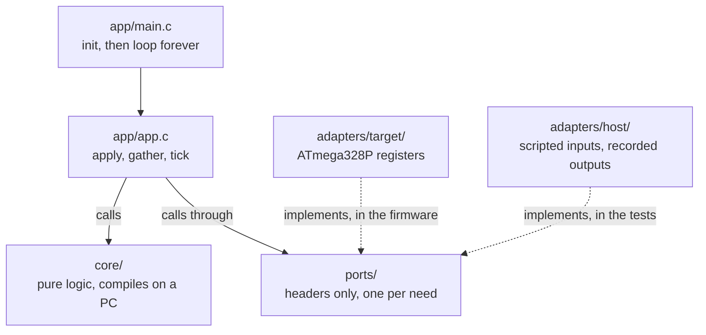
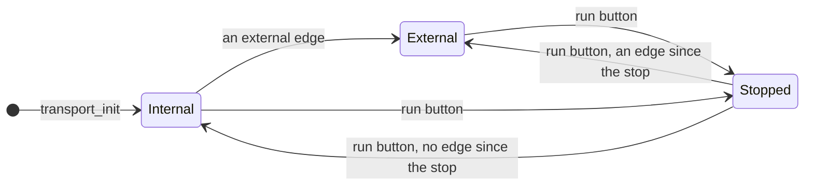

# nano_sequencer — architecture

What the firmware does today and how it is put together; what is still open is in [OPEN_ITEMS.md](OPEN_ITEMS.md).
The rules for the codebase are in [CLAUDE.md](../CLAUDE.md), the `CLAUDE.md` in each source folder and, for the parts of the core, of the MCU adapters and of the emulated board, `.claude/rules/`; the folder layout, the hardware list and the build commands are in the [README](../README.md); the plan is in [ROADMAP.md](ROADMAP.md) and the decisions taken in [DECISIONS.md](DECISIONS.md).
Function signatures, units and ranges are in the headers, and what each test program checks is in its source: neither is repeated here.

**How far this has been checked.** Everything here has run on the host (`make test`) and on the emulated board (`make sim`).
Only the first refactored firmware has been flashed to the real board; nothing since has, and most of the hardware it expects is not wired.
The open items say what to check on the board, part by part.
Timing figures marked as measured come from the emulated board; the rest are calculated.

## At a glance

| | |
|---|---|
| Target | ATmega328P (Arduino Nano, old bootloader), 16 MHz |
| Flash | 10786 bytes debug, 9502 release, 9654 midi, of 30720 below the bootloader |
| Static RAM | 816 bytes debug, 254 release, 288 midi (`avr-size` reports less: open item 5) |
| EEPROM | 52 of 1024 bytes: the calibration record (12, from address 0) and the crash log (40, from address 16) |
| Interrupts | One: Timer/Counter2 compare match, 1000 times a second, which adds one to a counter. The clock and reset inputs use interrupt flags, polled, with their interrupts off |
| Main loop | Never blocks. One sequencer tick a millisecond; every output is applied at the next tick boundary |
| Watchdog | About 250 ms, kicked once a tick. After a watchdog reset the firmware records in the EEPROM which part of the loop it had reached |
| Inputs | 16 steps × 4 bits, 8 mode switches and an 8-way selector on ten 74HC165s (SPI), a pot (ADC 6) and a modulation input (ADC 7), all read every 8 ms. Clock input (PB0), reset input (PD2) and run button (PD7), read every tick |
| Outputs | Pitch CV from an MCP4822 DAC (SPI), 1 V to the octave; gate (PD4); clock (PD5); 16 step lights on two 74HC595s (SPI); a level light (PD6, PWM). A serial log in the debug build, MIDI out in the midi build |
| Tempo | 30 to 285 BPM, a step being a sixteenth note (500 ms down to 52.6 ms) |
| Tests | 609 host tests in 57 programs: 370 for the core, 83 for the app loop, 153 for the target adapters, 3 for `main.c` |
| Coverage | 100% of lines (1669) and branches (758) in `core/`, `app/` and `adapters/target/` |
| Emulated board | 193 scenarios across the three images |
| MISRA | Zero findings from cppcheck's addon over four runs; one inline suppression (see "Static analysis") |

The sizes and counts are copied from [FIGURES.md](FIGURES.md), which `make figures` writes.

## Structure: ports and adapters

The sequencer logic is a pure core that never touches hardware.
The app gathers inputs through ports, hands them to the core as plain values, and applies what the core returns.



- **Ports are bound at link time.** The firmware links `adapters/target/`, the tests link `adapters/host/`, and both use the same headers.
  There are no function-pointer tables.
- **Build configurations are the same idea one level down.** `adapters/target/` holds two implementations of the log port and two of the MIDI output port, and the Makefile links one of each.
  There are no configuration macros.
- **The core calls nothing outside itself**, and only the app calls it.
  `seq_tick()` reads state and inputs and writes state and outputs; every module under it is the same kind of function, with its own test program.
- **Status codes.** Port functions that can fail return `port_status_t`.
  The numbers appear in the debug log, so they are fixed.
  Writes to a pin, the edge inputs, the button, the breadcrumb and the timebase cannot fail and return a value or nothing.
  The MIDI output cannot fail by arrangement: it says how much room it has, and the app writes no more.

**Bare metal.** No source file includes an avr-libc header.
Registers are declared as `extern volatile` variables and placed at their datasheet addresses by the linker (`atmega328p_regs.ld`).
The compiler is involved in four places: the `io_low` attribute on the low I/O registers, the `signal` attribute on the one interrupt handler (`__vector_7`), `__builtin_avr_wdr` for the watchdog, and a section attribute on the one byte of RAM kept through a reset.
The link step adds the chip's startup object from avr-libc (vector table, stack, `.bss` and `.data` set-up) and four libgcc helpers: the data copy, the bss clear, and the 16-bit and 8-bit divides.
Nothing is pulled from `libc` or `libm`.

## Reset to main loop

```mermaid
sequenceDiagram
    participant M as main
    participant A as app
    participant P as ports (target adapters)
    participant C as core
    M->>A: app_init()
    A->>P: platform_init()
    A->>C: seq_init(), cal_init()
    A->>P: read the reset cause, the calibration record and the crash log
    A->>C: decode the record; add a crash record after a watchdog reset
    A->>P: log the start-up line, and the newest crash if there is one
    loop forever: app_run_once()
        A->>P: timebase_elapsed_ticks()
        opt a tick has passed
            A->>P: 1. apply the outputs the last tick computed, kick the watchdog
            A->>P: 2. gather inputs (edges and button every tick, panel and ADC every 8th)
            A->>C: 3. cal_tick(), then bank_tick(), seq_tick(), midi_out_tick()
        end
        A->>P: log_poll(), midi_output_poll(), nv_poll(): one byte each
    end
```

`platform_init()` brings up the logger, the pins and ADC, the SPI bus, the two edge inputs, the MIDI output, the watchdog and last the timebase, which enables interrupts.
If it fails, `app_init()` logs the error, flushes the log (the only blocking call in the firmware) and `main` returns into libgcc's `_exit`, which masks interrupts and loops; the watchdog is never started, so the board halts and does not reset over and over.
No target init function can currently fail.
The loop begins about 0.8 ms after reset.

## The main loop and one tick

Each pass of `app_run_once()` asks the timebase how many 1 ms ticks have gone by.
With none, it polls the log, the MIDI output and the EEPROM and returns, a few microseconds a pass.
With one or more it runs one tick first, handing the count to the core so that a late pass loses no time.

1. **Apply outputs** from the previous tick: the pitch CV, then the gate, then the clock output, on every tick and ahead of everything else; then the step lights, the level light and any MIDI bytes; then the log lines (a transport change, the step that began, errors).
2. **Gather inputs.** Every tick: the clock and reset edges, the run button, and the room in the MIDI output.
   Every eighth tick: the ten panel bytes, the pot and the modulation input.
   Between scans the core is given the last snapshot again.
   A read's status is kept beside the snapshot so that a failure can be logged with its code, once per step.
3. **Run the core.** `bank_tick()` lets the pot set the amount the selector is on; the app copies the tempo and the three modulation amounts into the sequencer's inputs.
   `seq_tick()` works out whether a step begins and the level of every output after this tick.
   `midi_out_tick()` turns that into at most as many MIDI bytes as there was room for.
   The results wait for the next tick.

**Why outputs are a tick late.** Applying them at the start of the next tick means they change at the same point in every tick, however long the reads and the core took.
The price is 1 ms of delay, always the same.
The pitch goes ahead of the gate so that it is in place when the note starts, and it is written on every tick, changed or not, so that the apply step takes the same time every tick and a failed write is put right a millisecond later.

**Calibration mode** is the one exception to step 3: `cal_tick()` runs first on every tick, and if the panel asked for calibration at power-on it supplies the pitch CV and the gate from then on, and neither the sequencer nor MIDI out is called.

**Breadcrumb.** As each of the three steps begins, and when the tick ends, the app writes a place number to one byte of RAM that the startup code does not clear: 1 from start-up until the first tick, 2 applying outputs, 3 gathering inputs, 4 in the core, 5 between ticks.
After a watchdog reset that byte goes into the crash log.

**Fixed controls.** The direction, the range of steps, one-shot, the scale, the root and the gate length are inputs to the core with no hardware behind them.
`set_fixed_controls()` in `app.c` sets them once: all sixteen steps forward, looping, chromatic from the lowest pitch, a gate of half a step (open item 6).

**Timing, measured on the emulated board** at 150 BPM, where a step is exactly 100 ms:

| | Debug | Release and midi |
|---|---|---|
| Step period and gate width (50 ms) | Within 0.003 ms | The same |
| Panel scan period | 8 ms, within 0.12 ms | 8 ms, within 0.004 ms |
| DAC takes a note's pitch to its gate rising | 1.6 µs, pitch first | The same |
| First gate after reset | 2.4 ms | 2.1 ms |
| Gate rising to the first byte of its log line | 0.13 to 0.31 ms | No log |
| An edge at the clock input to its step's gate | 1.0 to 2.0 ms | The same |
| A press of the run button to the pattern stopping or starting | 20 to 21 ms after the contact settles | The same |
| MIDI Note On after its gate rises (midi build) | — | 0.40 ms; 0.73 ms for the first note after a start |

Steps begin on a tick boundary in every build, so the pins keep time to a few microseconds whatever the log is doing; only the log's own bytes jitter.
An external edge is noticed at the next tick and acted on at the one after, so steps move by up to a tick against a clock whose period is not a whole number of milliseconds.

## The core — `core/`

| Module | Question it answers |
|---|---|
| `seq` | Is a step due on this tick, and what are the outputs? |
| `clock` | How many pulses fell in these ticks, at a tempo or following external edges? |
| `transport` | Is the pattern running, and from which clock? |
| `debounce` | What level has this button settled at? |
| `engine_plain`, `engine_stage`, `engine_klee`, `engine_chance`, `engine_cartesian`, `engine_euclid` | Which step plays now, what is its note value, and is it tied to the next? |
| `prng` | What is the next random byte? |
| `address` | Which step comes next in this direction and range? |
| `note_map` | What pitch is this note value in this scale? |
| `panel` | What do the switches of this step, the mode switches and the selector read? |
| `gate` | Is the note still held? |
| `mod` | How far do an LFO and an amount move a value, or a chance? |
| `bank`, `pickup` | Which of eight amounts is the pot setting, and has it met it yet? |
| `pitch_cal` | What CV value gives this pitch? |
| `cal`, `cal_record` | Is this calibration mode, and what is being set? Are these stored bytes a table? |
| `errlog`, `crc8` | Which crash record is the newest, and what does this start-up add? |
| `midi_out` | Which MIDI bytes does this tick send? |

`seq` owns the clock, transport, engines, gate, note mapping, modulation and pitch calibration.
`bank`, `cal`, `cal_record`, `errlog` and `midi_out` stand beside it: the app calls them itself and they include nothing of the sequencer's.

### The clock

Elapsed ticks become pulses, 96 to the quarter note and 24 to a step.
At B BPM each tick adds B × 8 to a 16-bit phase counter, and each time it reaches 5000 one pulse is emitted and 5000 taken off.
Nothing is rounded, so there is no drift.
The tempo is limited to 300 BPM, which keeps a tick to one pulse at most; 0 stops the clock.

### Following an external clock

`clock_follow()` gives pulses in step with edges, at a ratio of a divide and a multiply.

- Every divide-th edge is a **sync edge**.
  Between two of them the clock gives exactly 24 × multiply pulses.
- Pulses are spaced as if this stretch will be as long as the last.
  If the next sync edge is late, the clock stops one pulse short and waits, so a step never begins ahead of its edge; when the edge comes it gives whatever is left.
- The first stretch, and one after a gap of 4 s or more, has nothing to go by: it is taken as 20 ticks long with a multiply of 1, so that step has a 10 ms gate.
- The ratio is read at each sync edge.
  Edges are seen once a tick, so the spacing is known to the millisecond.
- Running at a tempo ends the following.
  The first sync edge afterwards returns as many pulses as the caller says are left before its next step, so that step begins on the edge.

### The transport

Three modes: stopped, running on the internal clock, running on the external clock.



- **The run button** toggles, once it has settled; holding it is one press, and a button already down at power-on is not a press.
- **The clock chooses itself.** An edge takes the pattern over and it stays on the external clock, edges or none, until it is stopped.
  A stop forgets the external clock; an edge while stopped brings it back, so a start with a master running waits for its next edge.
- **A start** restarts the pattern from its first step; a change of clock does not.

`debounce_update()` takes the first reading as it stands and then changes level only after the raw reading has differed for 20 ticks without a break.

### The sequencer

- **Tempo and ratio.** The tempo amount (0 to 1023) is 30 plus a quarter of it, in BPM, on the internal clock.
  On the external clock the same amount is a ratio in seven bands of 147 counts: a step to every 4, 3 or 2 edges, a step an edge, or 2, 3 or 4 steps an edge.
  There is no hysteresis at the boundaries.
- **A step** is 24 pulses.
  When they have passed, the engine chosen by the low three mode switches is asked for the next step (0 plain, 1 stage, 2 Klee, 3 chance, 4 Cartesian, 5 Euclidean; 6 and 7 plain).
  A change of engine sends every engine back to its start.
- **What a step plays** is read when it begins, so a change on the panel is heard the next time its step comes round.
  Note value 0 is a rest.
  If the panel could not be read the step is neither a rest nor a pitch, and still begins on time.
- **A start** puts the clock, the engine and the gate back to their beginning and does not count that tick's time, so the first step is a whole one.
  On the internal clock the first step begins on the same tick; on the external clock it waits for the first edge.
- **Stopped:** the gate closes at once, the clock output is low, the pitch CV holds, and reset is ignored.
- **Reset** sends the engine back to its start and leaves the clock alone, so the first step plays at the next step boundary.
  On the external clock that is the next sync edge; a reset a tick later than its edge lets the wrong step begin first.
- **An early edge.** On the external clock, an edge that arrives while the gate and clock output are still high has its step held back one tick with both low, so every step has a rising edge of its own.
- **A change of clock** does not restart the pattern: the first external edge ends the step in progress and begins the next.
- **After a stall** at most one step begins per tick; the steps owed begin on successive ticks.
- **The gate** opens for a step that plays a pitch, for the gate length in pulses, or for a whole step at least if the engine ties the note to the next.
- **The pitch CV** is set when a note begins and by nothing else: it holds through rests, stops and resets, and is 0 until the first note.
- **The clock output** is high for the first 12 pulses of every step, note or not.
  It follows the clock, not the pattern.
- **The step lights** show the step that last began while the clock output is high; with the Klee engine they show its register.
- **The pulses** that fell on a tick are an output too, for the MIDI clock.
  While stopped with no external edge since the stop, the internal clock is kept going for them alone.

### The engines

An engine says which step it is, what note value it holds, and whether the note is tied to the next step; the sequencer owns the clock and says when.
Every engine has a state type, an init that doubles as its reset, and a step function with the same inputs and outputs (`core/engine.h`).
`seq.c` chooses with a `switch`; there are no function pointers, and the six states sit side by side in the sequencer's.

- **Plain.** The next step from the addressing, and its four switches as the note value.
- **Stage** (after the RYK M185).
  Steps 0 to 7 are eight stages' note values and steps 8 to 15 their controls: the low two switches are the length, 1 to 4 steps, and the high two the gate mode: single (the note on the first step only), repeat (on every step), hold (one note tied across the stage) or rest.
  The stages are addressed like steps, so direction, pendulum and one-shot work.
  The step reported is the stage's number.
- **Klee.** Each step's highest switch is a pattern bit and its low three a value.
  A load copies the sixteen pattern bits into a register (on the first step after a start, a reset or a change of engine, and when mode switch 3 is moved); every other step rotates it.
  The note is the sum of the values under the active bits, limited to 15.
  Mode switch 4 inverts the bit coming round, 5 ties every note to the next, and 6 and 7 are how many times in eight the bit is turned over at random.
- **Chance.** The plain steps, with mode switches 3 and 4 as how many times in four a step becomes a rest, and switch 5 picking each step at random from the range.
- **Cartesian.** The steps as a 4 × 4 grid crossed by two counters: x moves every 1 to 4 steps (switches 3 and 4) and y every 4 to 1 (switches 5 and 6).
- **Euclidean.** The plain steps, sounded only on 1 to 16 beats (switches 3 to 6, plus one) spread evenly over a bar of sixteen.

### Addressing

`address_next()` gives the step to play and moves on.
Its controls are a direction (forward, reverse, pendulum), a first and a last step, and one-shot.
A first step above the last runs round through step 15.
The state is a count of steps played in the cycle, not a step number, which makes reset and the end of a cycle the same in every direction; the cost is that a change of direction or range mid-cycle jumps (open item 7).

### Random numbers

`prng` is a 16-bit linear feedback shift register (taps 0xB400) with a period of 65535.
The sequencer owns the one generator, seeds it in `seq_init()` with a fixed number and hands the engines a pointer to it.
So the "random" choices are the same after every power-on, and a reset or a start does not begin them again.
Seeding it from something that differs between power-ons would be a few lines in the sequencer.

### The gate

One control, a length in clock pulses read when the step begins, so it scales with the tempo.
`gate_begin()` ends whatever gate was open and opens a new one if a note begins; `gate_advance()` counts it down.
The sequencer calls both, in that order, before it looks at the level, and that is where ties come from with no special case: a gate of a whole step would close on the pulse the next step begins on, and the next note has already reopened it.
A late step's gate is counted from when the step was due.

### Pitch calibration

`pitch_cal_cv()` turns a pitch in semitones into a CV value, 0 to 4095, through a table of five entries, one per octave, with straight lines between.
Measuring the output at each octave and storing what gives exactly 1 V, 2 V and so on corrects the DAC's gain, offset and curve together.
Until a table is stored the app supplies the ideal one: 0, 1000, 2000, 3000, 4000.

**Calibration mode** (`cal_tick()`) sets the table against a voltmeter.
It is entered only at power-on, if the last four steps read 10, 5, 10, 5, and left by switching off and setting an ordinary pattern.
In the mode nothing is sequenced, the gate is high and the clock output low.

| Control | Does |
|---|---|
| The first step's switches | Choose the point, 0 to 4: that many octaves above the lowest pitch |
| The pot | Trims the voltage: 64 mV below the nominal value to 63 above, 1 mV for every 8 counts |
| The lowest switch of the last step | Switching it on stores the voltage as that point. The gate drops for 250 ms to show it |

**The record** is twelve bytes: a version (1), the five entries as 16 bits each, low byte first, and a CRC-8 (polynomial 0x07, from 0).
It is taken only if the version and the checksum are both right; otherwise the ideal table stays.
There is one copy, so a power cut during a store loses the whole calibration (DECISIONS.md, decision 53).

### The crash log

Eight records of five bytes, used as a ring: a number (1 upwards, going round from 255 to 0), the reset cause, the place from the breadcrumb, a count of repeats, and the same CRC-8 started from 1.
A slot with a bad checksum is empty.
The newest record is the first that is not followed by the record numbered one above it.

`errlog_add()` does nothing unless the watchdog is among the reset causes.
If the newest record has the same cause and place its count goes up, stopping at 255; otherwise a new record takes the next slot.
Counting repeats keeps a firmware that crashes on every start from wearing the EEPROM out.
It records nothing finer than the five places, and it depends on the reset cause reaching the firmware (open item 2).

### MIDI out

`midi_out_tick()` turns what the sequencer did on a tick into bytes: at most the room it was told of, and never more than eight.
Every image runs it; only the midi build sends what it produces.

| Message | Bytes (hex) | Sent |
|---|---|---|
| Start | FA | When the pattern starts |
| Stop | FC | When it stops |
| Clock | F8 | Every 4 pulses: 24 to the quarter note, six to a step, running or stopped |
| Note On | 90, note, 64 | When a step with a pitch begins. Velocity 100 |
| Note Off | 80, note, 00 | When the gate is low and a note is sounding |

- Channel 1, no running status.
  The note is 24 plus the pitch, so the lowest is C1.
- The clock is counted from the sequencer's pulses, so it follows whichever clock the pattern runs from.
  A start begins the count again so that a clock falls where the first step begins.
- A tie sends the new Note On and then the old Note Off, or nothing if the pitch is the same.
- What does not fit is owed and goes later, as whole messages in a fixed order: Stop, Start, clocks, Note On, Note Off.
  A Note Off is always sent in the end; a Note On whose gate falls before it could go is given up.
- Bytes are queued in the apply step of the next tick and leave one a pass, 320 µs each, so a note's MIDI trails its gate by under a millisecond.

Not built: MIDI in, any control for the channel, velocity or lowest note, Continue and Song Position, All Notes Off.

### The amount bank

One pot, eight amounts of 0 to 1023, and a selector that says which the pot is setting.
`app.c` names the slots: 0 the tempo, 1 to 3 how much of the LFO goes to the note, the gate length and the step chance, and 4 to 7 held, shown and not used yet.
Position 0 is the tempo because 0 is what a board with no selector reads.

After the selector moves the pot is detached (`pickup`): the amount stays until the pot has been turned to meet it, which is a reading within 8 of it or two readings with it between them.
Every amount starts at 0 but the tempo, which takes the pot's first valid reading.
Nothing is stored.
The level light shows the selected amount, and so where the pot has to go.

### Modulation

`mod` multiplies the LFO's swing from its centre (512, with a dead zone of 16 either side) by an amount, giving a depth of 0 to 255 and a direction.
Read as each step begins:

| What | At a depth of 255 | Kept within | Below the centre |
|---|---|---|---|
| The note value | 7 places in the scale | 1 to 15; a rest is never moved | Moves it down |
| The gate length | 12 pulses | 1 to 24 pulses | Makes it shorter |
| The chance of a step dropping out | 255 in 256 | | No chance |

An LFO that could not be read is taken to be at its centre.
Nothing follows the LFO between steps.

### The panel and note mapping

The ten raw bytes are the sixteen steps, 4 bits each and MSB first (step 0 is the high nibble of byte 0), then the eight mode switches in byte 8, then the selector in the low three bits of byte 9.

A note value of 1 to 15 is the first fifteen notes of a scale from the root, carrying on into the next octaves.
The scales are chromatic, major, natural minor, major pentatonic and minor pentatonic, and the root adds 0 to 11 semitones.
Pitches run from 0 to 45 semitones, which is 3.75 V of the DAC's 4.095.

## Target adapters — `adapters/target/`

### Pins

| Pin | Nano | Direction | Used for |
|---|---|---|---|
| PB0 | D8 (ICP1) | input, pull-up | Clock input: a falling edge is latched by Timer/Counter1's capture flag |
| PB1 | D9 | output, idle high | 74HC165 load (active low) and 74HC595 latch (rising edge) |
| PB2 | D10 (SS) | output, idle high | MCP4822 chip select. It must be an output, or the SPI leaves master mode |
| PB3 | D11 (MOSI) | output | MCP4822 and 74HC595 data |
| PB4 | D12 (MISO) | input | 74HC165 data, through 1 kΩ so an ISP programmer can win |
| PB5 | D13 (SCK) | output | SPI clock to every chip |
| PC0, PC1 | A0, A1 | input, output | Nothing (open item 1) |
| PD0, PD1 | D0, D1 | as at reset | The USART, when a logger or the MIDI output enables it |
| PD2 | D2 (INT0) | input, pull-up | Reset input: a falling edge is latched by the INT0 flag |
| PD3 | D3 | input, pull-up | Free |
| PD4 | D4 | output, idle low | Gate output |
| PD5 | D5 | output, idle low | Clock output |
| PD6 | D6 (OC0A) | output, idle low | Level light, by pulse width from Timer/Counter0 |
| PD7 | D7 | input, pull-up | Run button, to ground |
| ADC6, ADC7 | A6, A7 | analog | The pot; the modulation input |

Each output's level is set before it is made an output, so no line glitches on the way.

### The adapters

- **Register map.** A register must appear in the header and in the `.ld` file; one missing from the `.ld` fails to link, but a wrong address there links silently.
  Each peripheral with a single user has a header of its own, so that a build that does not link that user has no unused names (MISRA rule 2.5).
  That is also why the MIDI adapter sets the USART up exactly as the logger does, receiver included.
- **ADC (`analog_reader.c`).** One function for both channels: it sets the channel, starts one conversion (about 104 µs) and polls for it, giving up with `ERR_TIMEOUT` after 10000 polls.
- **SPI (`spi.c`).** Master, mode 0, MSB first, 1 MHz.
  SS is made an output before master mode is chosen.
  A transfer takes 8 µs and its wait is bounded at 255 polls.
- **Step input and step lights (`shift_reg_reader.c`).** A read sends the two bytes for the lights, pulses PB1 low then high, and makes ten transfers of zeros.
  The rising edge of PB1 latches the lights in the same stroke, so they change once a scan and cost no pin.
  Chip 0, nearest the MCU, holds steps 0 and 1, with input H the MSB of step 0; chip 8 the mode switches; chip 9 the selector.
  The bytes are copied out only if every transfer succeeded.
  Neither chain has a chip select, so the DAC's frames pass through them and are ignored.
- **Pitch CV (`cv_output.c`).** A 16-bit frame to channel A of the MCP4822: `0001` (channel A, gain 2, output on) and twelve bits of value, 1 mV a step from its own 2.048 V reference.
  PDIP-8 pinout: 1 VDD (5 V, 100 nF to ground), 2 CS (D10), 3 SCK (D13), 4 SDI (D11), 5 LDAC (ground), 6 VOUTB (unused), 7 VSS, 8 VOUTA (the pitch CV).
  Checked against DS20002249B. A frame cut short is ignored by the part, so a failed write leaves the output where it was.
- **Gate, clock output, run button.** One `sbi`, `cbi` or pin read each.
  The outputs are bare 0 V and 5 V logic pins with no protection.
- **Clock and reset inputs.** A pulse can be far shorter than a tick, so each uses a flag the MCU latches on an edge (ICF1, INTF0) and holds until a one is written to it.
  The flags are polled once a tick with their interrupts off, which matters: neither vector has a handler.
  The edge is the falling one because the planned input stage is a transistor that pulls the pin low while the jack is high.
- **Level light (`level_output.c`).** Timer/Counter0 in fast PWM at 977 Hz.
  Fast PWM cannot hold the pin low, so for a level of 0 the compare output is taken off the pin.
- **EEPROM (`eeprom.c`).** `nv_read()` is immediate.
  `nv_write()` only copies up to 16 bytes into a buffer; `nv_poll()`, on every pass of the loop, starts at most one byte (about 3.4 ms each) and skips any byte that is already right, which is what makes storing one calibration point two or three byte writes.
  Starting a byte is a timed pair of instructions, done with interrupts off.
  Nothing reads back what was written: the record's checksum is the check, at the next start.
- **Watchdog (`watchdog.c`).** Reset only, 256 ms, set by a timed pair of writes before interrupts are on.
  The app kicks it once a tick and nowhere else, so it catches a stopped loop and a stopped tick alike.
  With the stock old bootloader a watchdog reset does not recover (open item 15).
- **Reset cause and breadcrumb.** `reset_cause_read()` reads the four reset flags (power-on 1, reset pin 2, brown-out 4, watchdog 8) and clears them.
  The breadcrumb is one byte in `.noinit`.
- **Serial logger (debug).** 115200 baud in double-speed mode (really 117647, 2.1% fast, the usual setting at 16 MHz).
  The port functions own the wording (`Step 3 Note = 11`, `Step 5 Rest`, `Reset = 2 Cal = 1`, `Crash 3 Place = 5 Count = 2`, `Cal point 2 = 2013`, `Transport = 2`) and write into a 128-byte ring queue; `log_poll()` sends one byte a pass.
  A message that does not fit is dropped whole.
  `null_logger.c` is the same functions, empty.
- **MIDI output (midi).** 31250 baud, exact at 16 MHz, with a 32-byte ring queue sent one byte a pass.
  `null_midi_output.c` discards everything and always reports room for 255.
- **Timebase (`timebase.c`).** Timer/Counter2 in clear-on-compare mode: 250 counts at 250 kHz.
  The handler increments a one-byte counter, so reading it is one instruction and needs no masking.
  `timebase_elapsed_ticks()` returns the difference since it was last asked, so a late pass loses no ticks, up to 255.

## Host tests — `adapters/host/` and `tests/`

`make test` builds 57 programs with the PC compiler under `-std=c99 -pedantic -Wconversion -Wshadow -Werror`.
There are two kinds:

- **35 link the code they test.** One per core module, with the sequencer's split by topic into six (`test_seq` and `test_seq_*`, sharing `tests/seq_fixture.h`) and MIDI out's into two (`test_midi_out` and `test_midi_out_notes`, sharing `tests/midi_out_fixture.h`), and five for the app loop (`test_app` and `test_app_*`, sharing `tests/app_fixture.h`), which link the real `app.c` and all of `core/` against `adapters/host/host_ports.c`.
  The fake ports script what the inputs return, record log calls in order, keep the level of each output, hold 64 bytes of storage that survive a re-init, and keep every MIDI byte written.
  Time is scripted, so the tests check on which tick each thing happens.
- **22 `#include` the one source file they test**, against `tests/fake_atmega328p_regs.h`, which stands in for every register header.
  This is how each target adapter and `main.c` are tested: the set-up values, the order of writes, the timed sequences, and the timeouts.

`make coverage` rebuilds the same programs with `--coverage -O0` and fails unless every `.c` file in `core/`, `app/` and `adapters/target/` has every line run and every branch taken.
`host_ports.c` is reported and not enforced.

What this does not show: the fakes are plain variables, so nothing here checks a register's address, the instructions a pulse relies on, that the vector reaches its handler, or real timing.
The emulated board covers those; what the hardware does in response still needs the board.

## Emulated board — `tools/sim/`

`make sim` runs each `output.hex`, exactly as it would be flashed, on an emulated ATmega328P ([avr8js](https://github.com/wokwi/avr8js), under Node's test runner).
Time is counted in CPU cycles, so every run gives the same result.
`lib/` (the chip) and `parts/` (the 74HC165, 74HC595, MCP4822, a pulse source, a switch) know nothing of the sequencer; `boards/` wires them to the pins; `scenarios/` says what each image must do.
The details are in [tools/sim/CLAUDE.md](../tools/sim/CLAUDE.md).

| Scenario file | Scenarios | Covers |
|---|---:|---|
| `debug.test.js` | 10 | The log against the panel, step timing, the USART settings |
| `release.test.js` | 14 | No USART, pin timing, the SPI and timer settings, the DAC frames |
| `calibration.test.js` | 30 | The mode, the stored record, a power cycle |
| `transport.test.js` | 48 | The clock and reset inputs, the run button, the pot and selector, the level light |
| `modulation.test.js` | 12 | The LFO moving the note, the gate length and the step chance |
| `engines.test.js` | 41 | The six engines and the step lights |
| `watchdog.test.js` | 21 | The watchdog, the breadcrumb and the crash log |
| `midi.test.js` | 10 | MIDI out on the midi image: the bytes, the notes and ties |
| `midi_clock.test.js` | 7 | MIDI out on the midi image: the clock, Start and Stop, a line with too much to send |

Most scenarios run on all three images.

**What it does not show.** The chip and the parts are models.

- The two edge flags are not avr8js at all: `lib/edge_flag.js` was written for this project from the datasheet, so it proves only that the firmware does what was intended (open item 12).
- The emulated SPI hands over whole bytes and does not move its pins, so nothing shows that mode 0 samples a real 74HC165 chain correctly (open item 8).
- Nothing analog is modelled: the DAC model decodes the frame and multiplies.
- The watchdog model only restarts the program and sets the flag.
  It says nothing about a real chip after a watchdog reset, or about the bootloader.
- The emulated EEPROM enforces the timed write but never wears or fails.
- The emulated clock is exact; the board's resonator is not.

**`make live`** runs the same board at real speed and shows it in a browser, with every control workable; its rules are in [tools/sim/live/CLAUDE.md](../tools/sim/live/CLAUDE.md).
It asserts nothing, is paced by the PC's clock, and is not part of `make check`.
Where the release image gives no log, the step and transport shown are the server's own count, not the chip's.

## Build — `Makefile`

The `Makefile` builds and flashes the firmware, and includes `tests/tests.mk` for the host tests and coverage and `tools/checks.mk` for the analysis, the emulated board, `make check` and `make figures`.

Every `.c` under `app/`, `core/` and `adapters/target/` is compiled once into `build/obj/`, the same way for every configuration.
A configuration only chooses which logger and which MIDI output are linked.
The chip has one USART, so an image has the log or MIDI out, not both.

| | Debug | Release | Midi |
|---|---:|---:|---:|
| Logger | `serial_logger.c` | `null_logger.c` | `null_logger.c` |
| MIDI output | `null_midi_output.c` | `null_midi_output.c` | `midi_output.c` |
| USART0 | The log, 115200 baud | Never switched on | MIDI out, 31250 baud |
| Flash | 10786 bytes | 9502 bytes | 9654 bytes |
| Static RAM | 816 bytes | 254 bytes | 288 bytes |

### Where the flash goes

[FIGURES.md](FIGURES.md) has the flash and the static RAM of each image by source file.
`make figures` writes it from the linker's map files.

The core is the largest part of every image.
The serial logger is nearly all of the difference between the debug build and the other two, in flash and in RAM: its queue and its message text are most of the debug build's static RAM.
The scale tables are constant data that this toolchain also copies to RAM.

## Static analysis

`make misra` runs cppcheck with its MISRA addon four times, each over the files linked together for one build: the debug, release and midi firmware, and the `test_app` host programs.
All four report zero findings; the count before the refactor was 165 ([misra-baseline.md](misra-baseline.md)).

There is one inline suppression, a false positive: rule 8.7 (advisory) on the timer interrupt handler in `timebase.c`.
The handler is referenced only by the startup object's vector table, which cppcheck never sees.
It is recorded in the source in the deviation format, so the reason sits beside it.

Findings in `tests/` are not reported, since test code is outside the standard. cppcheck implements only part of MISRA C, so zero findings is zero from this tool, not a claim of compliance.
How findings are handled is in [tools/misra/CLAUDE.md](../tools/misra/CLAUDE.md).

## Open items

The open items are in [OPEN_ITEMS.md](OPEN_ITEMS.md), by number; an "open item" in this document is one of those.
